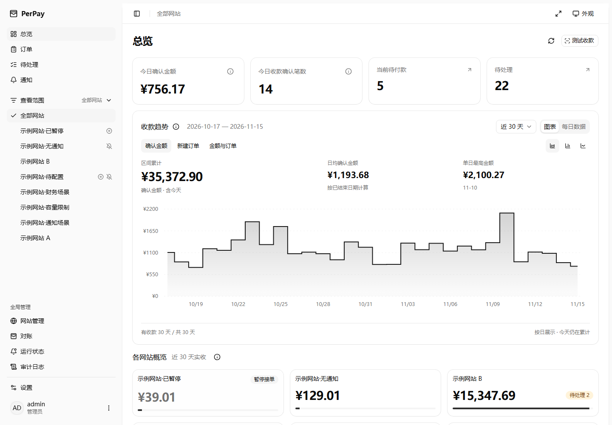
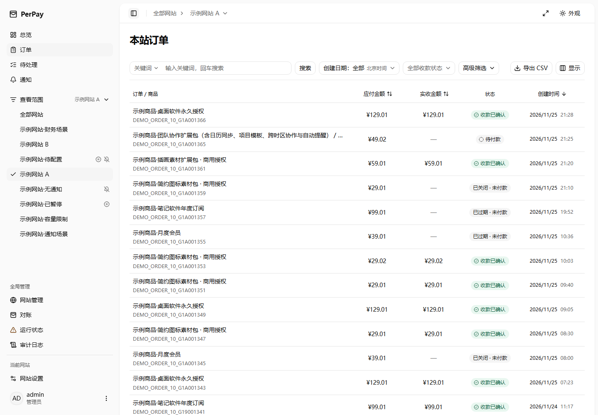

<!-- SPDX-License-Identifier: MIT -->

<p align="center">
  
</p>
<h1 align="center">PerPay</h1>
<p align="center"><strong>面向个人开发者、可自部署的支付宝个人收款系统</strong></p>
<p align="center">静态收款码收银台 · 自动查账对账 · 多网站与多账号 · 原生 API 与易支付 V1/V2</p>

<p align="center">
  <a href="https://github.com/Mashiro0619/PerPay/releases"></a>
  <a href="https://github.com/Mashiro0619/PerPay/pkgs/container/perpay"></a>
  <a href="LICENSE"></a>
</p>

<p align="center">
  <a href="#部署">快速部署</a> ·
  <a href="docs/alipay-setup.md">支付宝配置</a> ·
  <a href="docs/epay-integration.md">易支付接入</a> ·
  <a href="docs/integration-quickstart.md">原生 API 接入</a> ·
  <a href="docs/README.md">文档目录</a> ·
  <a href="CHANGELOG.md">更新日志</a>
</p>

---

## 工作方式

PerPay 将下单、展示静态收款码、服务端定时查账对账和异步回调通知整合为一套可自部署服务，无需在手机端运行监听程序：

1. 业务网站创建订单时，PerPay 在商品原价基础上分配小额加价以生成唯一应付金额（例如原价 `10.00` 元对应应付金额 `10.03` 元）。
2. 服务端通过支付宝开放平台账务明细接口定时拉取流水，按收款账号、应付金额和付款时间自动匹配订单。
3. 确认到账后，PerPay 向业务网站发送带签名的回调通知，由业务网站完成履约。

> **说明**：付款人须按收银台显示的完整应付金额付款；金额不符、超时付款或重复付款等情况进入后台待处理列表，供管理员人工核对。PerPay 不直接发起退款转账，外部退款后可在后台使用「标记已退款」登记。

## 主要功能

| 类别 | 说明 |
| --- | --- |
| 支付协议与收银台 | 内置公开收银台，提供原生 HMAC 签名 API 及易支付 V1 / V2 兼容接口 |
| 多网站与多账号 | 单实例支持多个业务网站与多个支付宝收款账号，支持固定、随机及按权重分配 |
| 查账与回调通知 | 服务端定时查账，自动发送签名通知并支持退避重试与后台手动重发 |
| 对账与异常处理 | 自动关联流水与订单；异常、冲突和通知失败集中处理，支持人工关联与争议撤销 |
| 统计与导出 | 今日指标、7/30/90 天趋势、按网站汇总、订单筛选与 CSV 导出 |
| 运维与备份 | Docker 部署、定时自动备份、网页/命令行恢复、历史归档与版本更新 |

## 界面预览

以下截图基于内置演示数据生成：

<table>
  <tr>
    <td width="50%" valign="top">
      <h3>全部网站总览</h3>
      <p>查看今日核心指标、收款趋势与待处理数量。</p>
      <a href="docs/screenshots/dashboard-light.png"></a>
    </td>
    <td width="50%" valign="top">
      <h3>单网站工作台</h3>
      <p>切换到单个业务网站，管理所属订单、金额与状态。</p>
      <a href="docs/screenshots/workspace-site.png"></a>
    </td>
  </tr>
</table>

## 前置条件

1. **运行环境**：已安装 Docker 与 Docker Compose v2 的服务器（支持 `amd64` / `arm64`，Windows 可使用 WSL2）。
2. **域名与 HTTPS**：正式收款需要公网域名、HTTPS 证书及反向代理（如 Nginx）；仅本机试用可使用 `http://localhost:6190`。
3. **支付宝收款码与开放平台应用**：需准备支付宝收款码或经营码，以及一个**已上线**且已开通「账务明细查询」权限的支付宝开放平台应用，详见 [支付宝配置指南](docs/alipay-setup.md)。

> **免责声明**：PerPay 是独立开源的自部署软件，并非支付宝官方产品。在法律允许范围内，因使用本项目导致的账号风控、受限、收付款异常或资金损失均由使用者自行承担，详见 [DISCLAIMER.md](DISCLAIMER.md)。

---

## 部署

<a id="1-下载配置"></a>

### 1. 下载配置

默认配置使用 `latest`（最新稳定版镜像）：

```sh
mkdir -p perpay && cd perpay
curl -fsSLo docker-compose.yml https://raw.githubusercontent.com/Mashiro0619/PerPay/main/docker-compose.yml
```

<a id="2-修改配置"></a>

### 2. 修改配置

编辑 `docker-compose.yml` 顶部变量：

| 配置项 | 说明 |
| --- | --- |
| `x-perpay-public-url` | **必填**。外部访问地址，如 `https://pay.example.com`（不含路径）。本机试用填 `http://localhost:6190`。 |
| `x-perpay-trusted-proxy-cidrs` | 可信反向代理来源 IP（如 `172.18.0.1/32`），用于识别真实客户端 IP；本机直连时留空。 |
| `x-perpay-host-port` | 默认 `127.0.0.1:6190:6190`（仅监听本机供反代转发）；端口冲突时修改宿主机端口。 |
| `x-perpay-image` | 默认 `ghcr.io/mashiro0619/perpay:latest`。 |
| `x-perpay-setup-token-enabled` | 默认 `"true"`，首次创建管理员需输入启动日志中的一次性口令，建议保持开启。 |

正式部署需通过反向代理提供 HTTPS 并转发至 `http://127.0.0.1:6190`，配置示例与代理 IP 获取方法见 [反向代理部署](docs/reverse-proxy.md)。

<a id="3-启动"></a>

### 3. 启动服务

```sh
docker compose config --quiet
docker compose up -d
docker compose ps
```

若启动异常，可执行 `docker compose logs --tail=100 app backup` 查看日志。

---

## 初始化

服务启动后，按以下顺序完成初始化：

1. **访问后台**：打开 `https://你的域名/admin/`（本机试用访问 [http://localhost:6190/admin/](http://localhost:6190/admin/)）。
2. **创建管理员**：执行 `docker compose logs --tail=100 app`，获取最新一条 `administrator_setup_required` 日志中的 `setup_token`，在页面提交并设置管理员密码（至少 6 位，建议使用高强度随机密码）。
3. **配置支付宝账号**：按后台向导完成 [支付宝配置](docs/alipay-setup.md)（填写 App ID、交换密钥、上传收款码并执行连接测试）。
4. **创建业务网站**：添加业务网站并绑定收款账号，在「接入与通知」中配置 **易支付 V1/V2** 或 **原生 API** 凭据与通知来源。
5. **实付验证**：通过业务网站发起一笔小额订单并完成实际支付，确认订单变为「收款已确认」且业务网站成功接收回调。

---

## 更新

PerPay 支持两种更新方式；在后台 **运行状态 → 官方更新** 点击 **立即更新** 时会自动识别当前部署模式：

### 方式 A：标准手动更新（默认）

在后台 **系统设置 → 备份与恢复** 执行一次备份后，于 `docker-compose.yml` 所在目录运行：

```sh
docker compose pull
docker compose stop app backup
docker compose up -d
docker compose ps
```

### 方式 B：后台在线一键更新（可选伴生更新器）

如需在后台直接触发自动备份、镜像拉取、容器切换与失败自动回滚，启动时附加伴生更新器配置即可：

```sh
docker compose -f docker-compose.yml -f docker-compose.updater.yml up -d
```

版本固定、回滚条件及伴生更新器安全隔离说明见 [更新与回滚](docs/maintenance.md#固定版本与回滚) 与 [在线一键更新](docs/maintenance.md#在线一键更新)。

---

## 数据与备份

默认 Compose 会创建 3 个持久化数据卷。切勿执行 `docker compose down --volumes`，否则会删除全部数据与密钥：

| 数据卷 | 用途 |
| --- | --- |
| `perpay-data` | 核心数据库与历史归档（订单、流水、配置、审计日志） |
| `perpay-backups` | 自动与手动生成的数据库备份 |
| `perpay-secrets` | 自动生成的主密钥（恢复加密配置时必需） |

- **定时备份**：默认每 24 小时备份一次，保留最近 7 份；可在后台 **系统设置 → 备份与恢复** 执行手动备份、恢复及历史归档。
- **异地保存**：请定期将数据库备份与原主密钥加密导出并分开异地保存，操作步骤见 [维护与恢复](docs/maintenance.md#启用与验证备份)。
- **账号恢复**：[重置管理员密码](docs/maintenance.md#忘记管理员密码) · [关闭管理员 IP 白名单](docs/maintenance.md#管理员-ip-白名单与离线恢复)。

---

## 文档索引

| 主题 | 文档 |
| --- | --- |
| 支付宝与反代配置 | [支付宝配置指南](docs/alipay-setup.md) · [反向代理部署](docs/reverse-proxy.md) |
| 业务对接 | [易支付 V1/V2 接入](docs/epay-integration.md) · [原生 API 快速接入](docs/integration-quickstart.md) · [Node.js 示例](examples/node-client/README.md) |
| 接口与错误参考 | [使用与接口参考](USAGE.md) · [业务错误码与重试](docs/integration-errors.md) · [OpenAPI 规范](openapi.yaml) |
| 多网站与运维 | [多网站与多账号管理](docs/multi-site.md) · [维护、升级与恢复](docs/maintenance.md) · [数据与隐私](docs/privacy.md) |
| 二次开发 | [开发导航](docs/development/README.md) · [前端开发](web/README.md) · [开发验证](docs/development/ui-verification.md#本地预览) |

完整目录见 [docs/README.md](docs/README.md)，版本变更见 [CHANGELOG.md](CHANGELOG.md)。技术栈：Node.js 24 · TypeScript · Hono · SQLite · React · Vite · shadcn/ui。

## 许可证与友链

- 开源协议：[MIT License](LICENSE) · [免责声明](DISCLAIMER.md) · [第三方声明](NOTICE) · [安全报告](SECURITY.md)
- 友链：[Linux Do](https://linux.do/)
