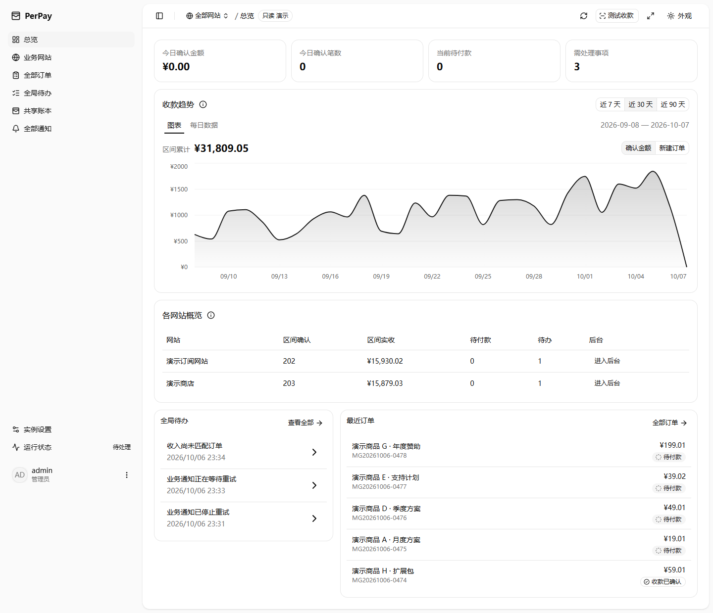
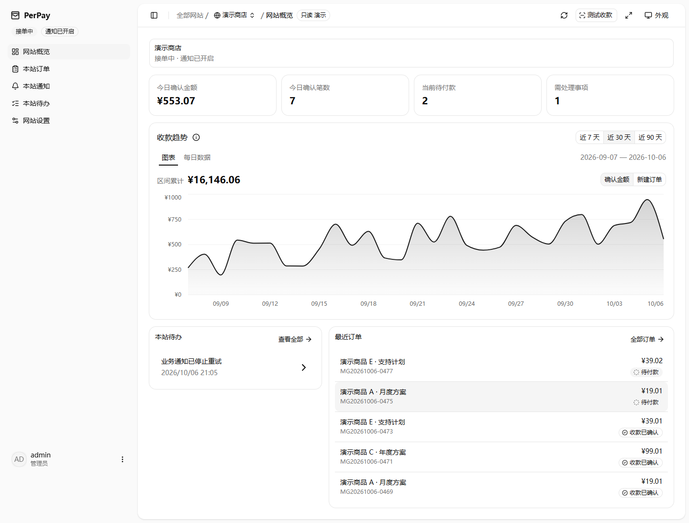

<!-- SPDX-License-Identifier: MIT -->

<p align="center">
  
</p>
<h1 align="center">PerPay</h1>
<p align="center"><strong>不用装手机监听软件，也不用签约成为支付宝商户，面向个人开发者的自托管支付系统</strong></p>

<p align="center">
  <a href="https://github.com/Mashiro0619/PerPay/releases/latest"></a>
  <a href="https://github.com/Mashiro0619/PerPay/pkgs/container/perpay"></a>
  <a href="https://nodejs.org/en/about/previous-releases"></a>
  <a href="LICENSE"></a>
  <a href="https://github.com/Mashiro0619/PerPay/stargazers"></a>
</p>

<p align="center">
  <a href="#界面预览">界面预览</a> ·
  <a href="#部署">快速部署</a> ·
  <a href="docs/alipay-setup.md">支付宝配置</a> ·
  <a href="USAGE.md">接入文档</a> ·
  <a href="CHANGELOG.md">变更日志</a>
</p>

## 功能

| 功能 | 说明 |
| --- | --- |
| 收款码收银台 | 展示应付金额与二维码，查询付款状态 |
| 查账与对账 | 定时查询支付宝流水，可在运行状态手动发起查账，自动确认收款，支持异常处理与人工关联 |
| 订单管理 | 按创建日期搜索、筛选订单，查看 PerPay 确认时间并导出 CSV |
| 多业务网站 | 同一管理员的一级汇总与二级网站后台，独立密钥和订单权限，各站可指定、随机或按权重选择支付宝账号；[接入指南](docs/multi-site.md) |
| 通知 | 签名回调、失败重试与投递记录 |
| 总览 | 今日确认金额／收款确认笔数、待处理提醒及近 7 / 30 / 90 天趋势 |
| 自托管运维 | Docker 部署、自动备份与版本检查 |
| 界面显示 | 自定义系统名称、商家帮助链接、首页图表样式，支持明暗主题 |

技术栈：**Node.js 24 · TypeScript · Hono · SQLite · React · Vite · shadcn/ui**。

## 界面预览

| 一级：全部网站 | 二级：网站后台 |
| --- | --- |
|  |  |

截图均为本地只读合成数据。创建业务网站时填写名称并选择收款账号，其他设置按需配置。[两级后台操作与预览验收](docs/development/admin-workspaces.md)。

## 部署前准备

- Linux 服务器，安装 Docker 和 Docker Compose v2；Windows 使用 WSL2 的 Linux 容器。
- 公网使用需准备域名和 HTTPS 反向代理。
- 支付宝收款码（经营码可选），以及能查询该收款账户入账流水的开放平台应用。也可向订单对应的支付宝账号转账，金额须与订单一致。

## 部署

### 1. 下载配置

在服务器终端执行：

```sh
mkdir -p perpay && cd perpay
curl -fsSLo docker-compose.yml https://raw.githubusercontent.com/Mashiro0619/PerPay/main/docker-compose.yml
```

### 2. 修改配置

编辑 `docker-compose.yml` 顶部的配置：

| 配置项 | 怎么填 |
| --- | --- |
| `x-perpay-public-url` | 你的 HTTPS 地址，如 `https://pay.example.com`，不带路径。 |
| `x-perpay-trusted-proxy-cidrs` | PerPay 容器实际看到的直连代理 IP 或网段，多个用逗号分隔；HTTPS 部署必填。 |
| `x-perpay-host-port` | 默认 `127.0.0.1:6190:6190`，只允许从宿主机访问。 |
| `x-perpay-setup-token-enabled` | 默认 `"false"`，首次只需设置管理员密码；改为 `"true"` 后，还需输入服务器启动日志中的一次性初始化令牌。 |

反向代理安装在宿主机时，将域名转发到 `http://127.0.0.1:6190`，并通过 `X-Forwarded-For` 传递客户端 IP。Docker 转发后的代理来源可能是桥接网关，不要直接照填 `127.0.0.1`。宿主机与容器代理的完整示例见 [反向代理部署](docs/reverse-proxy.md)，不要信任所有来源。

仅在本机试用：把 `x-perpay-public-url` 改为 `http://localhost:6190`，代理配置留空，无需域名。

### 3. 启动

首次启动前，先限制域名访问，只允许自己；创建管理员后再对外开放。

```sh
docker compose config --quiet
docker compose up -d
docker compose ps
```

启动失败时查看日志：`docker compose logs --tail=100 app backup`。

## 初始化

当前源码默认关闭初始化令牌，首次只需设置管理员密码。需要启用时，把 Compose 顶部的 `x-perpay-setup-token-enabled` 改为 `"true"`，执行 `docker compose up -d app`；源码部署设置 `PERPAY_SETUP_TOKEN_ENABLED=true` 后重启服务。该开关只接受 `true` 或 `false`，不影响已有管理员。

已发布镜像的初始化方式以对应版本为准：`1.0.0-alpha.2` 固定要求令牌，尚不支持此开关；默认镜像 `latest` 跟随稳定版。首次创建管理员前继续限制访问。

1. 访问 `https://你的域名/admin/`；本机试用访问 [http://localhost:6190/admin/](http://localhost:6190/admin/)。已初始化的实例直接登录。
2. 如果页面要求**初始化令牌**，在部署目录运行 `docker compose logs --tail=100 app`，读取最近一次启动时 `administrator_setup_required` 事件中的 `setup_token`；源码部署从服务启动终端读取。关闭时不显示令牌输入框，也不生成或输出令牌。
3. 按页面要求设置管理员密码，至少 6 个字符，建议使用更长的随机密码。创建成功后用该密码登录。带令牌的版本会立即使令牌失效；未完成初始化时重启服务会生成新令牌，请重新读取启动日志。
4. 按 [支付宝配置图文教程](docs/alipay-setup.md) 完成向导，检查收款就绪。

初始化令牌只用于首次创建管理员，不是登录密码。不要公开包含令牌的启动日志；公网部署通过后台所在的 HTTPS 地址提交初始化，不把令牌放进网址。

订单结束后的应付金额默认冷却 10 分钟再复用；这不是补付宽限期，也不能完全消除静态码的归属风险。付款截止与重试规则见 [接入说明](USAGE.md#金额复用冷却与付款截止)。

## 更新

在 **运行状态 → 官方更新** 选择检查通道、开关自动检查或手动检查。默认开启自动检查：登录后检查一次，后台页面可见且联网时每 6 小时检查；页面隐藏或离线时暂停，恢复后补查已到期的检查。偏好保存在当前浏览器，并在同源标签页之间同步，不修改服务器配置。

检查通道只有“仅稳定版”和“包含预发布版”，默认“包含预发布版”，同时检查已公开的稳定版和预发布版，与当前安装版本无关。已有“仅稳定版”偏好会保留，旧的“跟随当前版本”偏好会按新默认值处理。检查通道不会改变 Docker 镜像标签，也不会自动下载或安装更新。

检查由服务器访问 GitHub，不发送订单、配置或密钥；各有效通道的成功结果缓存 5 分钟，失败冷却 60 秒，不影响收款。后台失败不会反复弹窗，手动检查可在冷却结束后重试。

更新前做好备份，在原部署目录执行：

```sh
docker compose pull
docker compose up -d
```

默认使用稳定版 `latest`，预发布版不会覆盖它。预发布 Release 附件固定到对应版本，详见 [预发布版本与更新通道](docs/maintenance.md#预发布版本与更新通道)；固定版本或回滚见 [维护说明](docs/maintenance.md#固定版本与回滚)。

## 数据与备份

| 数据卷 | 内容 |
| --- | --- |
| `perpay-data` | 订单和配置 |
| `perpay-backups` | 数据库备份 |
| `perpay-secrets` | 自动生成的主密钥，恢复配置时必需 |

自动备份默认启用，可在 **系统设置 → 自动备份** 调整。请将备份和主密钥另存到服务器之外。

**不要删除数据卷或执行 `docker compose down --volumes`。** 恢复步骤见 [维护说明](docs/maintenance.md#恢复数据库)。

忘记管理员密码？见 [停服重设密码](docs/maintenance.md#忘记管理员密码)，无需删除数据。

## 文档导航

| 文档 | 内容 |
| --- | --- |
| [支付宝配置](docs/alipay-setup.md) | 应用、密钥、收款码与首次收款检查 |
| [业务网站接入](USAGE.md) | 请求签名、订单接口、通知与金额匹配规则 |
| [文案术语表](docs/glossary.md) | 收款、查账、通知及字段来源的统一用词 |
| [调用端 Demo](examples/node-client/README.md) | 业务网站接入示例 |
| [维护说明](docs/maintenance.md) | 备份恢复、版本升级、回滚与密码重设 |
| [数据与隐私](docs/privacy.md) | 付款人相关字段、原始证据、会话信息与实际保留规则 |
| [前端开发](web/README.md) · [OpenAPI](openapi.yaml) | 构建、测试与接口定义 |

## 许可证

PerPay 使用 [MIT License](LICENSE)。第三方代码与素材说明见 [NOTICE](NOTICE)。

## 友链

[Linux Do](https://linux.do/)
