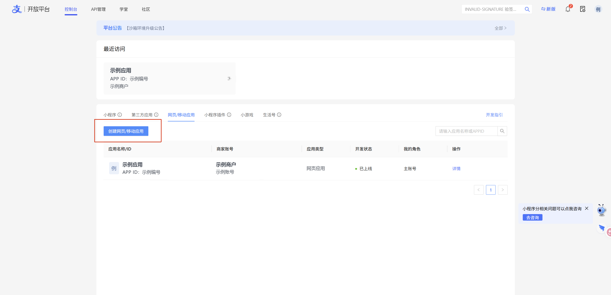
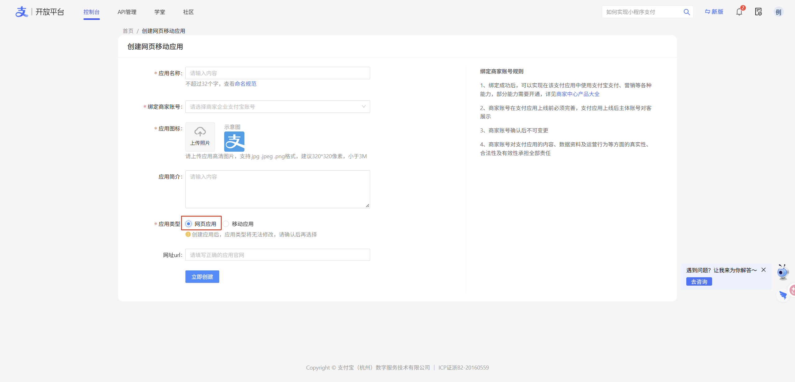
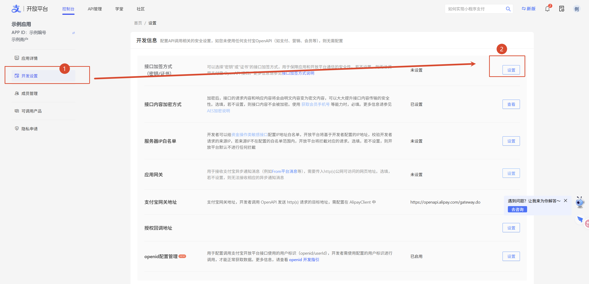
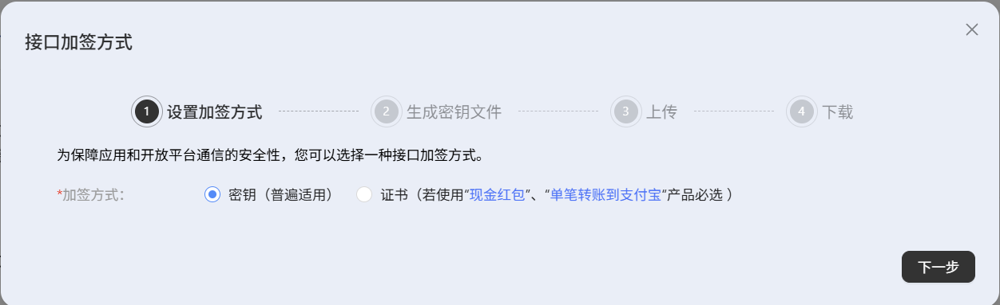
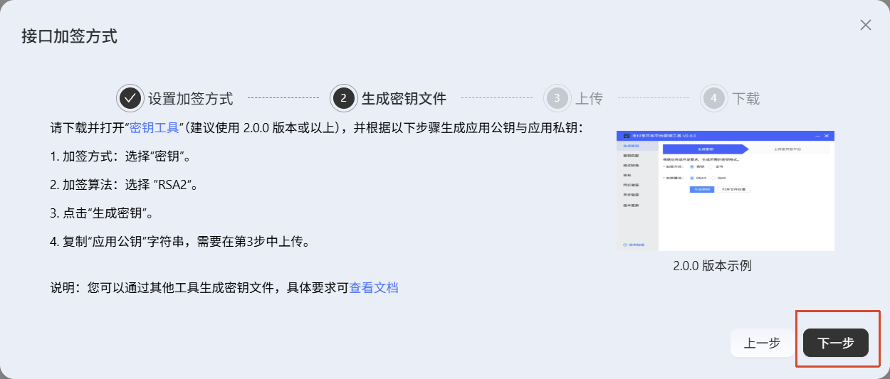
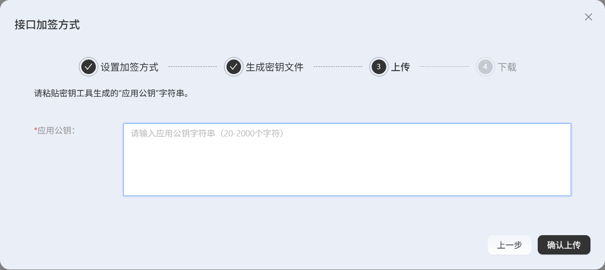
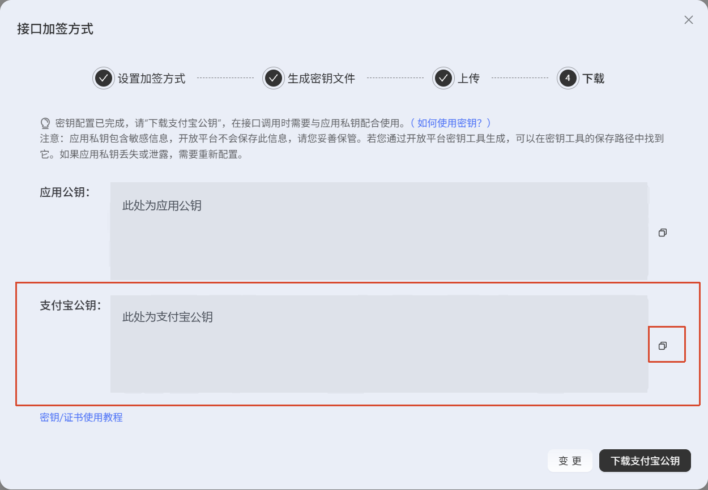

<!-- SPDX-License-Identifier: MIT -->

# 支付宝配置指南

本文说明如何在 PerPay 中完成支付宝开放平台应用接入、密钥交换、收款码上传与首次试收款验证。

开始前请先完成 [安装与管理员初始化](../README.md#部署)，登录后进入后台 **系统设置 → 配置向导**（已完成的步骤可直接跳过）。

> 相关文档：[文档目录](README.md) · [易支付接入](epay-integration.md) · [原生 API 接入](integration-quickstart.md) · [维护与恢复](maintenance.md)

---

## 准备条件自检

配置前需确认具备以下 3 项条件：

| 检查项 | 确认位置 | 要求 |
| --- | --- | --- |
| 支付宝收款码 | 支付宝 App（收款码或经营码） | 二维码清晰可识别，且归属账号与下方开放平台应用一致 |
| 已上线的开放平台应用 | [支付宝应用管理](https://open.alipay.com/develop/manage) | 已获取 **App ID**，且应用状态为 **已上线**（“开发中”无法正常查账） |
| 账务明细查询权限 | 应用「产品绑定 / 接口权限」 | 已开通 [账务明细查询](https://opendocs.alipay.com/open/02awe0)（`alipay.data.bill.accountlog.query`） |

> **收款码与经营码**：普通收款码与经营码均支持，推荐申请经营码。登录对应支付宝账号后搜索「经营码」按提示申请并保存二维码图片，留待第 5 步上传。

---

## 1. 在 PerPay 中创建支付宝账号

1. 在配置向导进入 **配置支付宝账号**，点击 **添加支付宝账号**。
2. 填写便于辨识的账号名称，点击 **创建账号并继续**。
3. 保持 **接收新订单** 开启（后续可随时暂停该账号接单）。

如需接入多个支付宝收款账户，为每个实际账户分别创建独立的账号记录，并配置对应的应用密钥与收款码。

---

## 2. 获取并填写 App ID

- **已有应用**：进入 [支付宝应用管理](https://open.alipay.com/develop/manage)，打开已上线应用并复制 **App ID**。
- **尚未创建**：选择 **网页/移动应用 → 网页应用**，按平台流程完成创建、接口权限开通与上线审核。

将 **App ID** 填入 PerPay 对应账号的「应用信息」并点击 **保存配置**。后续密钥交换均针对该应用操作。

---

## 3. 生成并上传应用公钥

配置过程涉及三把密钥，作用与存放位置如下：

| 密钥 | 生成方 | 存放位置 | 用途 |
| --- | --- | --- | --- |
| 应用私钥 | PerPay 生成（或导入） | 保留在 PerPay（加密存储） | 对发往支付宝开放平台的查账请求签名 |
| 应用公钥 | PerPay 生成后复制 | 上传至支付宝应用控制台 | 供支付宝验证请求签名 |
| 支付宝公钥 | 支付宝平台生成后复制 | 填回 PerPay | 供 PerPay 验证支付宝返回账单的签名 |

操作步骤：

1. 在 PerPay 点击 **生成应用密钥**，复制生成的 **应用公钥**（若已有现成私钥，可展开「导入已有应用私钥（可选）」直接导入）。
2. 进入支付宝应用控制台：**开发设置 → 接口加签方式 → 设置**。

   

3. 加签模式选择 **密钥（普通适用）**，点击「下一步」。

   

4. 跳过官方密钥生成工具，直接进入上传步骤。

   

5. 粘贴从 PerPay 复制的 **应用公钥**，点击 **确认上传**。

   

支付宝官方步骤参考：[设置密钥加签方式](https://opendocs.alipay.com/common/02kdnc)。

---

## 4. 填回支付宝公钥并测试连接

1. 上传应用公钥后，复制支付宝页面生成的 **支付宝公钥**。

   

2. 返回 PerPay，粘贴至 **支付宝公钥** 输入框，点击 **保存并检查**。
3. PerPay 会立即发起一次真实查账并验签：
   - **检查通过**：继续第 5 步。
   - **检查失败**：已填内容会保留，根据错误提示核对 App ID、两把公钥是否填反、应用是否已上线及账务明细查询权限是否已开通，修正后重新测试。

查账间隔初期保持默认即可，后续可在 **系统设置 → 查账设置** 调整，参数含义见 [查账节奏](../USAGE.md#查账节奏)。

---

## 5. 上传收款码并完成试收款

1. **上传收款码**：切换至当前账号的 **收款码** 页签，上传收款码图片，确认解析内容正确后保存。
2. **确认首次查账**：进入 **运行状态**，待首次查账状态显示正常后，该账号即具备接单条件。
3. **创建业务网站**：回到向导的 **配置网站**，创建业务网站并选择上述收款账号（支持多账号分配）。
4. **试收款验证**：进入向导 **试收款**，创建一笔小额测试订单，按收银台显示的完整应付金额扫码支付，确认状态自动更新为「收款已确认」。
5. **配置业务接入**：在 **完成业务联调 → 配置网站接入** 中按业务端协议选择对应指南：
   - 易支付兼容插件：[易支付 V1/V2 接入指南](epay-integration.md)
   - 自研接口调用：[原生 API 快速接入](integration-quickstart.md)

> **注意**：配置 **通知来源（`notification_origin`）** 时仅填写协议与域名，不带路径。例如回调地址为 `https://shop.example.com/payment/notify`，通知来源应填 `https://shop.example.com`。全部验证通过后，建议立即按 [启用与验证备份](maintenance.md#启用与验证备份) 完成备份与主密钥异地保存。

---

## 密钥维护与常见情况

### 更换支付宝应用密钥

入口：**系统设置 → 支付宝账号 → 对应账号 → 应用信息 → 更换应用密钥**。

未投入收款的账号会直接替换密钥对；已在线收款的账号采用两步切换，新密钥验证通过前不影响当前查账：

1. 点击生成新密钥，系统生成 **待启用** 密钥对（此时继续使用旧密钥查账）。
2. 将 **待启用应用公钥** 上传至同一支付宝应用（支付宝侧参考：[更新密钥／证书](https://opendocs.alipay.com/common/05wt1i)）。
3. 将支付宝重新生成的 **支付宝公钥** 填入 PerPay 的 **新的支付宝公钥**。
4. 点击 **验证并启用**，查账与验签均通过后自动切换为新密钥。

如需取消更换：若尚未向支付宝上传新公钥，直接点击 **放弃新密钥**；若已上传，须先在支付宝恢复旧应用公钥并将对应支付宝公钥填回 PerPay，再点击放弃。更换密钥不会改变 App ID 和查账配置。

### 更换原生通知签名密钥与配置冲突

- **通知签名密钥**：在 **业务网站 → 网站设置 → 接入与通知** 查看或轮换。明文仅在独立弹窗中短暂展示，关闭弹窗后清除。轮换后新通知与后续重试立即使用新密钥，业务端需及时同步（过渡期可同时接受新旧密钥）；若操作超时，先点击 **重新读取密钥状态** 核对后再决定是否重试。
- **配置版本冲突**：保存时若提示已被修改，点击 **重新读取账号** 核对最新配置后再提交，当前未保存草稿不会丢失。
- **旧版沙箱账号**：仅支持查看历史数据，无法继续收款；请新建已上线正式应用的账号并切换站点绑定。
