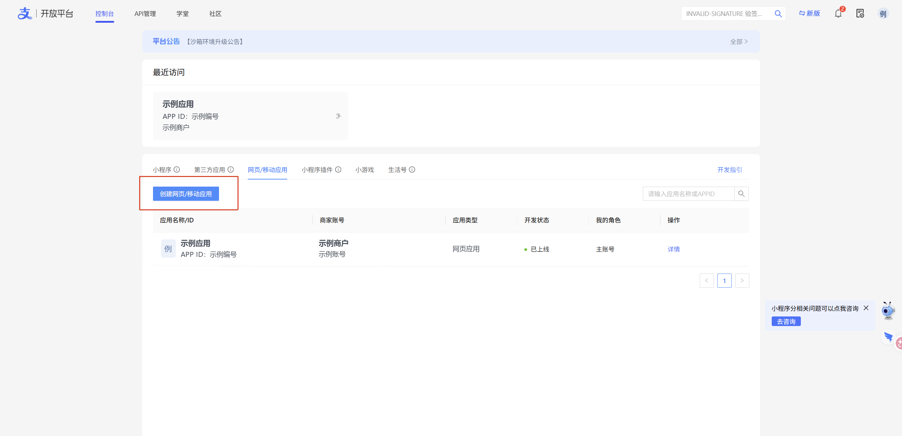
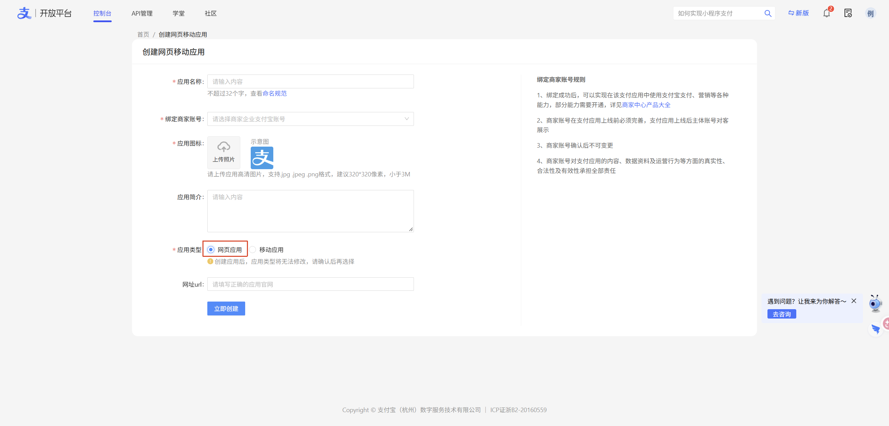
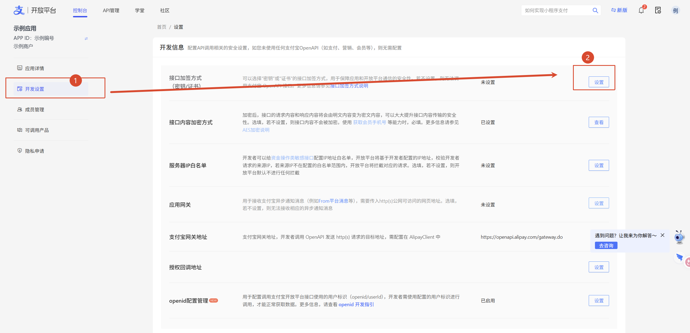
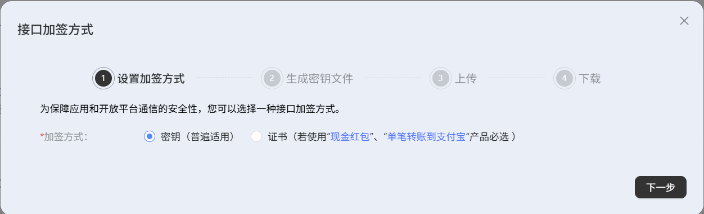
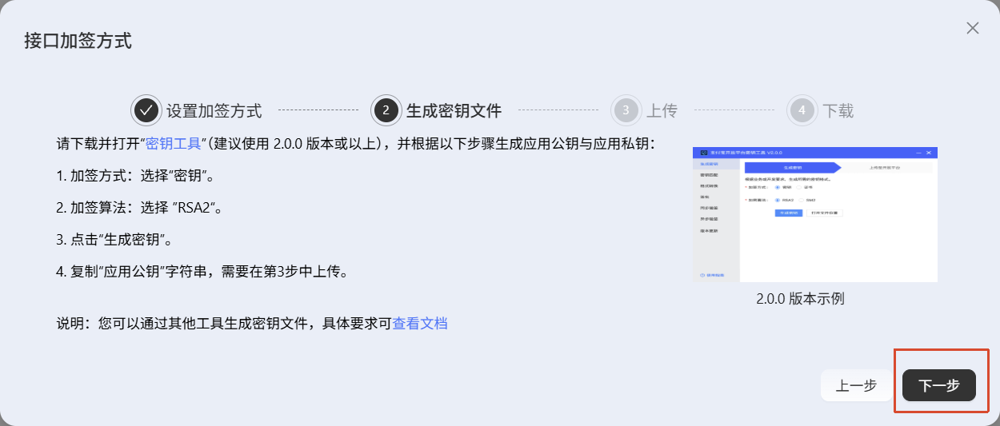
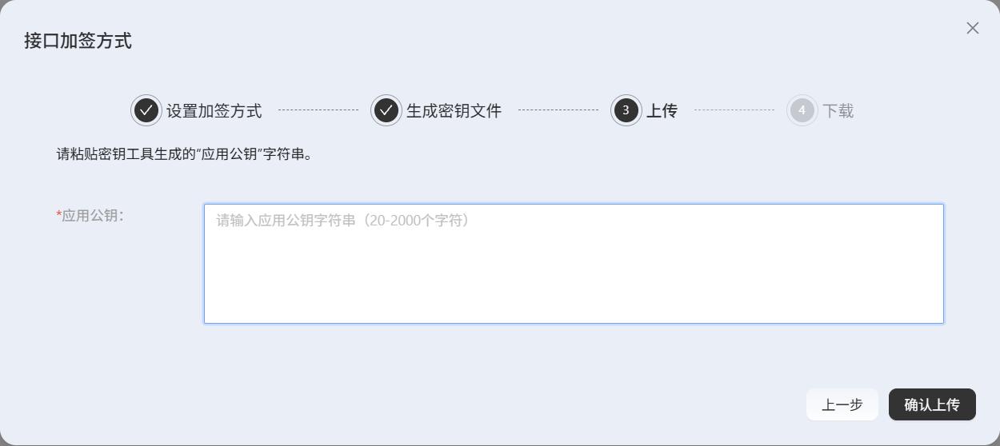
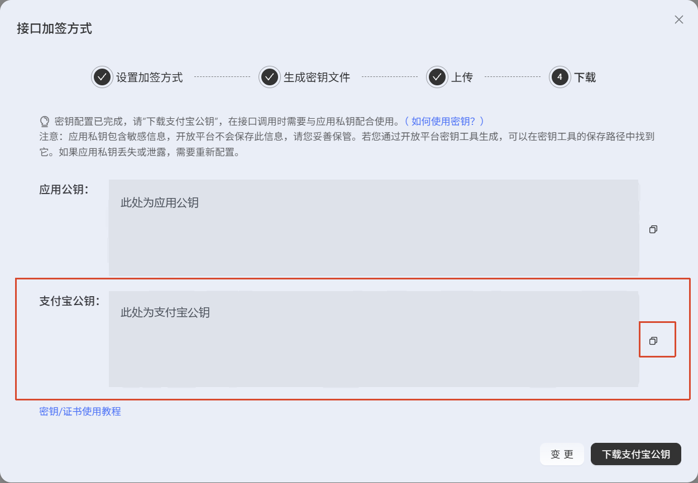

<!-- SPDX-License-Identifier: MIT -->

# 支付宝配置图文教程

先[部署并登录 PerPay](../README.md#部署)，再打开 **系统设置 → 配置向导**。按下面的步骤准备支付宝应用、填写密钥、上传收款码，最后完成一笔实际收款。已经配置过的部分可以跳过。

[文档导航](README.md) · [业务网站接入](integration-quickstart.md) · [维护与恢复](maintenance.md) · [免责声明](../DISCLAIMER.md)

## 准备条件自检

| 准备内容 | 确认位置 | 完成标志 |
| --- | --- | --- |
| 支付宝收款账号和收款码 | 保存该账号的收款码图片；经营码的申请方式见下文。 | 二维码能被识别，收款账号与下面应用查询的账号一致。 |
| 已上线的开放平台应用 | [支付宝应用管理](https://open.alipay.com/develop/manage)。 | 已取得 App ID，应用状态为“已上线”。 |
| 账务明细查询权限 | 应用的产品／接口权限，核对[账务明细查询接口](https://opendocs.alipay.com/open/02awe0) `alipay.data.bill.accountlog.query`。 | 应用可查询对应收款账号的账务明细。 |

新应用需要在支付宝控制台提交资料、开通相关产品并完成上线。没有账务查询权限时，先按控制台提示申请；“开发中”的应用不能用于正式查账。有多个收款账号时，每个账号分别填写自己的应用、密钥和收款码。

### 申请并保存经营码

经营码**可选，但推荐**，普通收款码也可以使用。账号需满足上面的账务查询条件。申请经营码的步骤如下：

1. 登录实际收款的支付宝账号，搜索 **“经营码”**，进入支付宝提供的申请入口。
2. 按页面要求填写资料并完成申请；已有经营码可直接打开经营码页面。
3. 保存二维码图片，供[第 5 步](#5-上传收款码或经营码并创建网站)上传。

## 1. 创建 PerPay 支付宝账号

在向导的 **配置支付宝账号** 中，点击 **添加支付宝账号**，填写账号名称，再点击 **创建账号并继续**。页面进入“应用信息”，顶端会列出待补充项。

保留“接收新订单”开启。补齐配置并完成首次查账后，业务网站就可以使用这个账号收款；关闭开关后，不再给这个账号分配新订单。

## 2. 打开或创建支付宝应用

已有应用：在[应用管理](https://open.alipay.com/develop/manage)打开应用，记下 **App ID**。

新建应用：从 **网页／移动应用** 进入创建流程，选择 **网页应用**，填写应用信息和关联账号，再完成上线与接口开通。

将该应用的 **App ID** 填入 PerPay 的“应用信息”，点击 **保存配置**。后续密钥也使用这个应用。

## 3. 生成并上传应用公钥

在 PerPay 点击 **生成应用密钥**，复制生成的 **应用公钥**。三类密钥的填写位置如下：

| 密钥 | 放在哪里 | 用途 |
| --- | --- | --- |
| 应用私钥 | 由 PerPay 加密保存。 | 为查账请求生成签名，证明请求来自你的应用。 |
| 应用公钥 | 从 PerPay 复制，上传到支付宝应用。 | 让支付宝检查请求的签名。 |
| 支付宝公钥 | 从同一支付宝应用复制，填回 PerPay。 | 让 PerPay 检查返回的账单确实来自支付宝。 |

首次接入时已有应用私钥，可展开 **导入已有应用私钥（可选）**，导入并保存后复制对应公钥。私钥不填写到支付宝公钥字段，也不作为网站通知签名密钥使用。

在支付宝控制台上传应用公钥：

**① 打开 开发设置 → 接口加签方式 → 设置。**

**② 选择“密钥（普通适用）”，点击“下一步”。**

**③ 使用 PerPay 已生成的公钥，直接进入上传步骤。**

**④ 粘贴 PerPay 的应用公钥，点击“确认上传”。**

平台说明见官方[设置密钥加签方式](https://opendocs.alipay.com/common/02kdnc)。

## 4. 填回支付宝公钥并检查连接

上传完成后，复制同一应用页面提供的 **支付宝公钥**，填入 PerPay 的“支付宝公钥”。

确认应用已上线且具有查询权限，点击 **保存并检查**。PerPay 会保存配置，发起一次真实的账单查询，并检查支付宝返回数据的签名：

| 检查结果 | 下一步 |
| --- | --- |
| 连接检查通过 | 继续补齐页面列出的其他配置，例如“待补充：收款码”。 |
| 连接检查未通过 | 按错误原因核对 App ID、应用公钥、支付宝公钥、接口权限或网络。已保存的配置会保留，修正后再次保存并检查。 |

初次配置可使用默认查账节奏。需要调整时，到 **系统设置 → 查账设置** 修改，参数说明见[查账节奏](../USAGE.md#查账节奏)。

## 5. 上传收款码或经营码并创建网站

1. 在当前账号切换到 **收款码**，上传或拖入该账号的二维码图片，核对识别结果后保存。
2. 在 **运行状态** 查看首次查账是否成功，确认账号已经可以接收新订单。
3. 回到向导的 **配置网站**，创建或选择业务网站，指定收款账号；多个账号可随机或按权重分配。
4. 进入 **试收款**，选择网站并创建小额测试订单。该订单会实际收款，请按收银台显示的准确应付金额付款，再查看确认结果和实际使用的账号。
5. 在 **完成业务联调** 中选中同一网站，点击 **配置网站接入**，按业务系统选择协议：

| 业务系统 | 接入步骤 |
| --- | --- |
| 已有易支付插件 | 选择插件使用的易支付 V1/V2，配置网关、商户 PID 和凭据，见[易支付接入](epay-integration.md)。 |
| 自行开发原生 API | 生成该站 API 密钥，需要回调时生成通知签名密钥，见[原生接入](integration-quickstart.md)。 |

通知域名只填协议、域名和必要的端口，不填后面的路径。例如回调地址是 `https://shop.example.com/payment/notify`，这里填 `https://shop.example.com`。先让业务网站能接收通知，再在 PerPay 开启通知并保存；业务网站如果只通过查单确认付款，可以保持通知关闭。

最后从业务网站实际下单并付款，确认业务网站通过通知或查单得知付款结果，并完成充值、发货或商品交付。出现问题时，从向导打开该网站的订单和通知记录。完成接入后，按[维护说明](maintenance.md#启用与验证备份)配置备份，并单独保存原主密钥。

## 更换应用密钥

打开 **系统设置 → 支付宝账号 → 对应账号 → 应用信息**，点击 **更换应用密钥**。

尚未完成应用接入配置时，会直接替换密钥对；已经复制或上传过旧公钥的，须重新上传新公钥。已完成接入的账号按以下顺序切换：

1. 生成新密钥，确认页面显示为 **待启用**；此时仍使用原密钥。
2. 将 **待启用应用公钥** 上传到同一个支付宝应用。
3. 从支付宝重新复制本次提供的公钥，填入 **新的支付宝公钥**。
4. 点击 **验证并启用**。只有账单查询和签名检查都通过，新密钥才会生效。

验证失败时，按原因修正后重试。待启用密钥会保存，离开或刷新页面后可继续。若决定放弃且已在支付宝上传新公钥，先在支付宝恢复当前应用公钥，将恢复后获得的支付宝公钥同步到 PerPay，再点击 **放弃新密钥**。

更换密钥后，当前账号的 App ID 和查账设置保持不变。支付宝侧的生效说明见[更新密钥／证书](https://opendocs.alipay.com/common/05wt1i)。

## 配置冲突与旧账号

如果其他标签页或管理员改过同一账号，点击 **重新读取账号**，确认页面中的修改后再保存。服务器上已经有待启用密钥时，先读取并采用那份应用配置，再决定启用或放弃。

旧版本留下的沙箱账号可以查看历史记录。要继续收款，需新增使用已上线应用的正式账号，再把业务网站改为使用这个账号。

## 通知签名密钥维护

原生 API 的通知密钥在 **业务网站 → 网站设置 → 接入与通知** 中生成或轮换。生成后配置业务系统验签，填写通知域名，再开启通知并保存。

更换密钥后，新发出和重试的通知使用新密钥，已经发出但尚未结束的通知可能仍使用旧签名。业务网站需要同步更新验签配置；已经完成的通知不会因此自动重发。

网站密钥在单独的弹窗里查看和复制，关闭弹窗后清除显示内容。生成或更换后如果页面没有明确结果，先点击“重新读取密钥状态”，再查看当前密钥，避免重复更换；未保存的配置会保留。若提示配置已被修改，先重新读取并核对，再继续操作。
