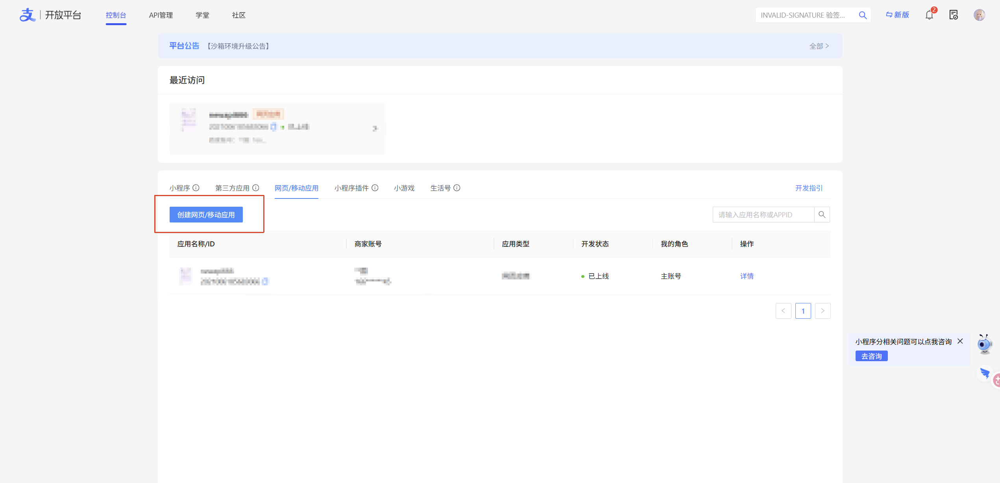
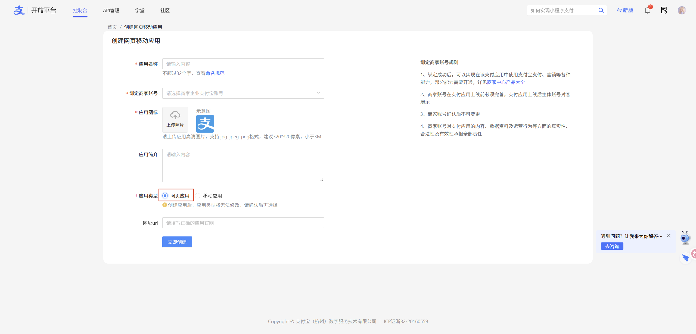
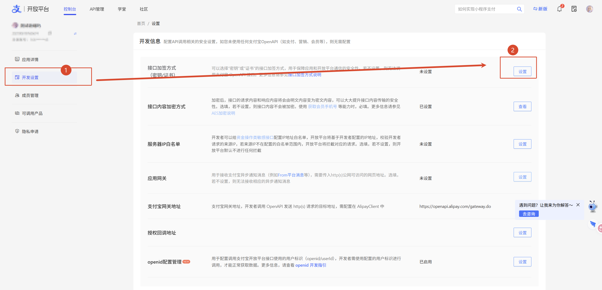
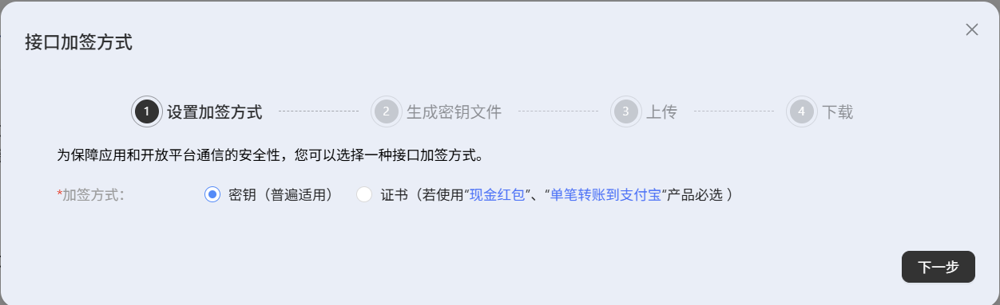
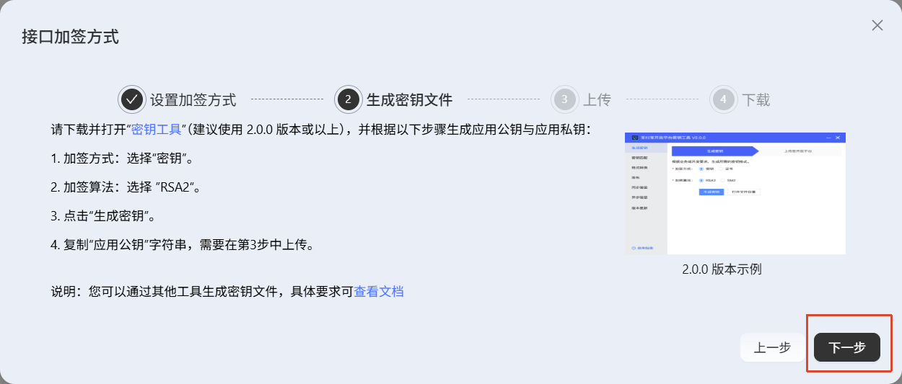
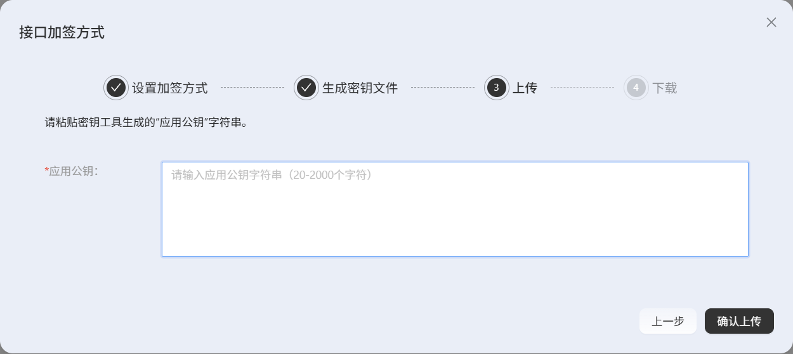
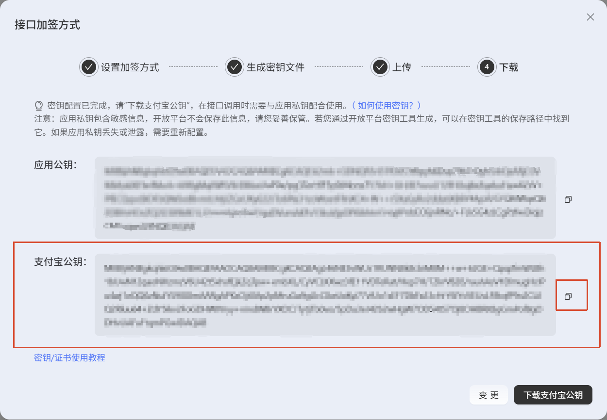

<!-- SPDX-License-Identifier: MIT -->

# 支付宝配置图文教程

[部署](../README.md#部署)并登录 PerPay，打开 **系统设置 → 配置向导**。

## 准备

- 保存支付宝收款码图片；经营码也是可选形式，不需要专门申请经营码才能使用。
- 使用对应收款账户的开放平台应用，并确认能查询该账户的入账流水。
- 也可向订单选中的支付宝账号转账，付款金额须与订单一致。PerPay 后台和收银台沿用二维码，不提供另外的转账入口。

一个 PerPay 支付宝账号包括收款码、App ID、环境、支付宝公钥及应用私钥。多个账号分别配置，不要把一个账号的二维码与另一个账号的应用混用。

## 1. 准备应用公钥

**应用密钥对**由一把**应用公钥**和一把**应用私钥**组成。公钥复制到支付宝，私钥由 PerPay 加密保存，用于签名请求；不要把应用私钥当成支付宝公钥或业务系统的 API 密钥。

- **尚未配置**：在“支付宝账号”详情中点击 **“生成应用密钥对”**，复制生成的应用公钥，再进入下一步。
- **已有应用公钥**：直接复制当前公钥；已在支付宝完成配置则直接进入下一步，不需要重新生成。
- **首次接入时已有自己的应用私钥**：在尚未生成密钥对前，在账号详情点击 **“导入已有应用私钥”**。保存对应私钥，并将配套的应用公钥配置到支付宝。

已保存的 **支付宝公钥** 会回填到账号详情，可查看和修改。首次配置尚未填好时可先保存草稿，未完成配置的账号不接收新订单。换钥时的验证启用表单不会沿用旧公钥，仍需填写本次上传后从支付宝复制的公钥。

### 需要更换应用公钥时

展开默认收起的 **“更换应用密钥”**，点击 **“更换应用密钥对”**。此操作会同时生成新的应用公钥和应用私钥。

如果尚未保存支付宝接入配置，确认后会直接替换原密钥对；先前已复制或上传原公钥时，需要重新上传新的应用公钥。

已经接入支付宝时，按四步操作：

1. **生成**：新密钥对先加密保存为 **待启用**，当前收款继续使用原密钥。
2. **上传**：复制新的应用公钥，进入同一支付宝应用的接口加签设置完成上传。
3. **填回**：上传后，重新复制该应用页面显示的 **支付宝公钥**。回到该账号的 **“更换应用密钥”**，填入新值；此处必填，不会沿用已保存的旧公钥。
4. **验证**：点击 **“验证并启用”**。PerPay 用新私钥执行一次只读账单查询，并验证支付宝响应签名，通过后才切换密钥。

本次只更新当前应用的密钥，保留 App ID、环境和查账参数，无需返回第一步或再次保存旧配置。

待启用密钥保存在该账号内，离开页面不会丢失。当前账号在启用前仍使用原密钥，其他账号照常运行；若已向支付宝上传新公钥，请尽快验证启用，避免影响该账号查账。

验证失败不会更换当前密钥；修正配置后可以重试。验证不发起支付、不登记账本流水，也不会将收款健康状态直接标记为就绪。启用会重启当前账号依赖密钥的后台工作，不会改变已有订单和流水的归属。

离开向导、刷新页面或重启 PerPay 不会丢失待启用密钥，也不会自动启用。暂时不更换可选择 **“放弃新公钥”**；这只清除 PerPay 暂存的密钥，不会撤回支付宝侧的上传。若已经上传新公钥，请先在支付宝恢复当前使用的应用公钥，并在 PerPay 的支付宝设置中同步恢复后获取的支付宝公钥，再放弃，以免影响查账。支付宝侧的生效时间与过渡期以其当前页面提示为准。

已有私钥导入仍用于首次接入或切换支付宝应用，不能绕过上述验证流程直接替换当前应用的私钥。

支付宝侧步骤参见官方[设置密钥加签方式](https://opendocs.alipay.com/common/02kdnc)及[更新密钥／证书](https://opendocs.alipay.com/common/05wt1i)。

## 2. 创建网页应用

已有网页应用可直接打开，记下 **App ID**；新建应用按以下步骤操作。

**① 打开创建入口。** 进入 [支付宝应用管理](https://open.alipay.com/develop/manage) 的 **网页／移动应用**，点击 **创建网页／移动应用**。

**② 应用类型选择“网页应用”。** 填写应用信息、绑定收款账号，选择 **网页应用** 后点击 **立即创建**。不要选择“移动应用”；应用类型创建后无法修改。

创建后进入应用详情，记下 **App ID**。

## 3. 上传应用公钥

**① 开发设置 → 接口加签方式 → 设置。**

**② 选择“密钥（普通适用）”，点击“下一步”。**

**③ 直接点“下一步”。** PerPay 已保存应用密钥对，无需再下载工具生成。

**④ 粘贴 PerPay 的应用公钥，点击“确认上传”。**

## 4. 填回支付宝公钥

复制下方红框里的 **支付宝公钥**。

回到 PerPay，填入同一应用的 **App ID** 和 **支付宝公钥**，点击 **“保存并检查”**；保存和连接检查分别展示结果，检查失败仍保留配置，可以修正后重试。默认使用生产环境；PerPay 的参数在独立“查账设置”中调整，默认值可以直接用，升级后的已有配置保留原值。详见[查账节奏](../USAGE.md#查账节奏)。

## 5. 完成剩余配置

1. **收款码**：在同一账号页面点击或拖入图片，核对识别结果后保存。
2. **业务网站**：创建网站并指定一个账号，或选择多个账号随机／加权分配，再到该网站页面生成、查看或轮换 API／通知密钥。由 PerPay 生成的客户端 ID 和 API 密钥只配置在业务系统后端，不与支付宝应用密钥混用。升级保留的旧网站仍用 `default` 和原密钥，新网站不依赖它。未签发 API 密钥也可在选择网站后进行管理员小额真实测试。
3. **通知与备份**：每站分别配置通知和返回 origin；启用通知前先生成该站通知密钥。不启用通知时，业务网站需主动查单。备份属于系统设置，需保管主密钥卷并测试恢复。
4. **检查收款就绪**：等待首次查账和自动确认通过。失败时查看“运行状态”，检查 App ID、公钥、查询权限和网络。

[调用端 Demo](../examples/node-client/README.md) · [接口与通知说明](../USAGE.md)

## 通知签名密钥维护

在 **业务网站 → 进入后台 → 网站设置 → 接入与通知** 中显式生成或轮换通知签名密钥，先配置接收端，再填写该站通知 origin、开启通知并保存。生成密钥不自动开启通知，保存配置也不自动生成密钥；轮换不修改网站的通知开关、来源或投递策略。

轮换后需及时更新业务系统的通知验签配置。新发送和重试的通知使用新密钥，已经发出的请求可能仍使用旧密钥；接收端可在过渡期短暂兼容新旧密钥（密钥疑似泄露时不应继续信任旧密钥）。轮换不会自动重发已完成的通知。结果未确认时不要反复轮换，应刷新配置，再通过“查看通知密钥”核对当前密钥。

网站页在显式查看或轮换后显示明文。使用后点击“隐藏密钥”，或离开该网站编辑页，即可清除页面明文。**服务端仍保存密钥，通知继续启用；已复制到系统剪贴板的内容需自行清除。** 需要时可再次显式查看。
隐藏同时使尚未返回的密钥显示请求失效，晚到响应不会重新显示明文；已提交的生成或轮换仍会完成，配置版本照常更新，需等操作结束后再显式查看。隐藏不是取消服务端轮换。
