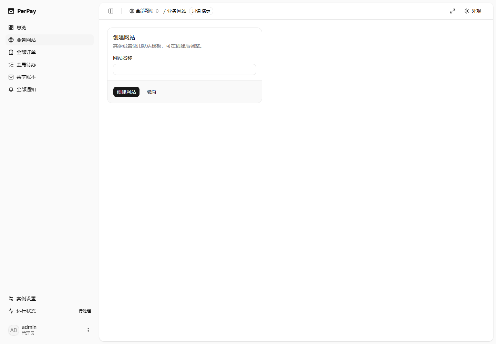

<!-- SPDX-License-Identifier: MIT -->

# 管理后台布局与信息精简验收

日期：2026-10-07。开发分支：`feat/1.0.0`，版本 1.0.0。未修改数据库、支付路径、收银台或签名协议。

## 本轮变化

- 网站只填写名称即可创建，其余配置复制加载的默认模板；模板不可用不能创建。关闭通知、空来源、不自动签发密钥的初始规则不变。未知创建结果固定原请求重试。
- 所有网站搜索控件移除；分页／加载更多保留。同名网站用短 ID 区分，完整 ID 留在接入信息和技术详情。订单关键词、精确订单号、日期和状态查询保留。
- 设置区最大 56rem，数字控件约 12rem，名称最大 28rem；相关短字段桌面双列、移动端单列。标签与输入控件分离，开关贴近名称。
- 网站设置按组保存，模板使用一份跨标签草稿；普通保存不再泛化确认。高级通知策略收起，服务端字段错误或原生表单校验会展开并定位。
- 二级订单／通知不逐行重复网站名称和客户端 ID；一级保留网站名称。技术标识与原始证据继续从详情操作中查看、复制。
- 正常运行环节精简，明细按需展开；有待办或统计未知时仍直接显示实际数量或未知状态。采集失败保留原因、计划重试及安全恢复提示，窗口等细节可展开。

## 保留的安全边界

暂停接单、关闭通知、来源变更、密钥轮换、删除及财务操作继续明确确认影响。
保留管理员白名单锁出提醒、离线恢复说明、密码／密钥风险、未保存草稿保护、网站作用域、版本冲突和未知操作结果保护。
隐藏密钥不等于取消轮换；网络恢复不自动提交写操作；停止等待不等于撤销财务操作。

## 浏览器对照

真实 Chrome 154（Playwright 驱动），使用同一临时实例的两个合成网站和同一组订单。
旧版由修改前启动的演示服务提供，新版通过开发预览访问同一后端；最终还构建生产资源并刷新演示服务。

检查 24 个页面：一级概览、网站列表、创建页、默认模板、本站概览、四组网站设置、订单与详情、通知与详情、待办、共享账本、运行状态、支付宝接入、经营码、采集、安全、备份、界面显示、高级设置和向导。
每页覆盖 1440／1920／390px 与浅色／深色，前后共 288 张检查截图。逐组合查看缩略总览，并对创建、订单设置、接入通知、移动端及异常状态单独放大核对。新版没有页面级横向溢出、输入框嵌套标签或超过 192px 的数字框。

1920px 浅色实测：

| 页面 | 修改前 | 修改后 |
| --- | --- | --- |
| 创建网站 | 8 个数字框及多组设置，页面高 1552px | 仅名称与操作，内容在首屏内 |
| 本站订单设置 | 数字框宽 1126—1150px，标签被挤压 | 数字框 192px，设置区 896px，四项双列 |
| 接入与通知 | 页面高 1322px，重试策略全部展开 | 默认首屏内，策略按需展开 |
| 本站通知 | 页面高 2347px | 同页记录减少重复网站信息后 1467px |

上述高度包括视口最低高度，不把剩余空白当成内容；订单、通知等长列表继续分页，不强行压缩成一屏。

另在 1440 浅色、1920 深色、390 深色中注入合成读取响应，检查加载、模板读取失败、空网站列表和重名长名称；实际操作高级设置折叠与无效字段提交，确认自动展开、焦点定位。浏览器模拟只改变测试响应，没有向后端提交写请求。
移动端侧栏打开、关闭和本站导航实际点击通过。测试与截图均无真实支付宝或通知请求。

## 当前界面

## 自动化与交付

`npm run check` 与 `npm run build`：API 契约／生成类型、双端类型检查、前后端全量测试及管理员／收银台／服务端构建。
最终结果：后端 1040 项通过，3 项 POSIX 权限测试在 Windows 跳过；前端 91 个文件、1110 项通过。
新增回归覆盖标签关联、错误定位、最小创建请求、模板失败、未知创建重试、分页重名选择和二级列表信息去重；原有隔离、密钥隐藏、财务恢复及草稿保护继续验证。

原子提交：`b939e79` 表单布局，`302cb8f` 网站流程，`01afbbc` 页面信息精简，`0098640` 浏览器复核后的模板按钮与通知说明修正；截图、使用说明和本记录另行提交。

没有执行真实支付、外部通知、Docker／Linux 部署或远程 CI。未推送、合并、打标签、发布或部署；本地多网站评估记录和安全审计报告未修改。
