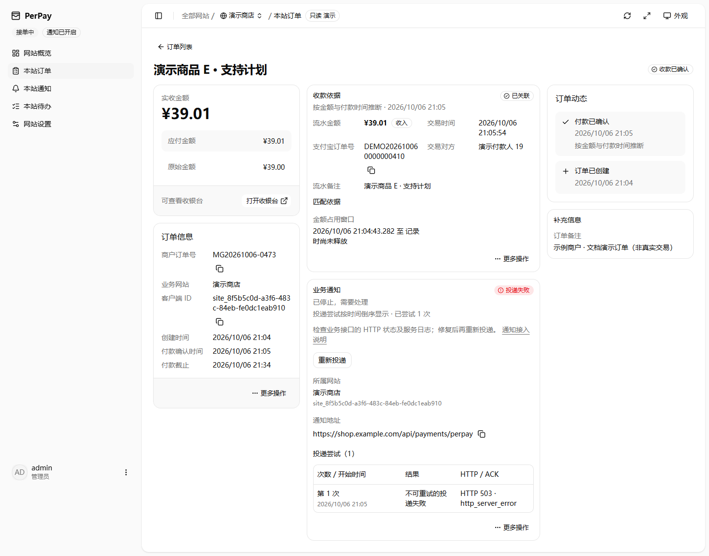
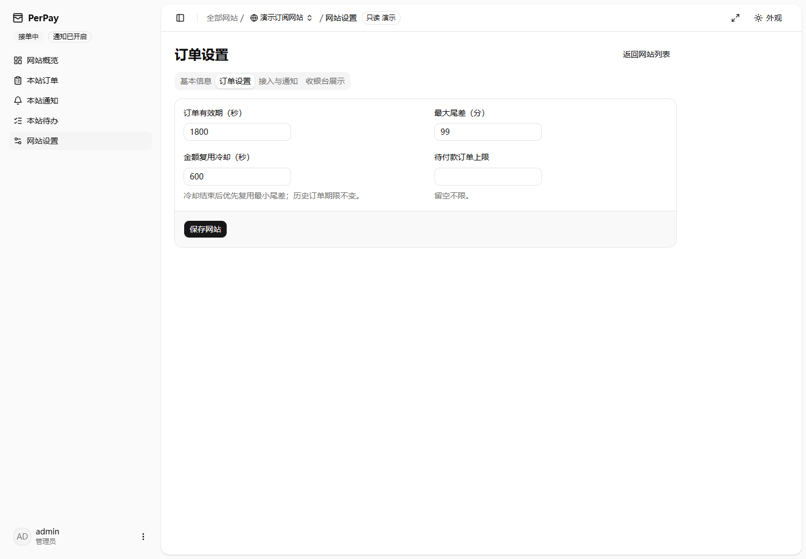
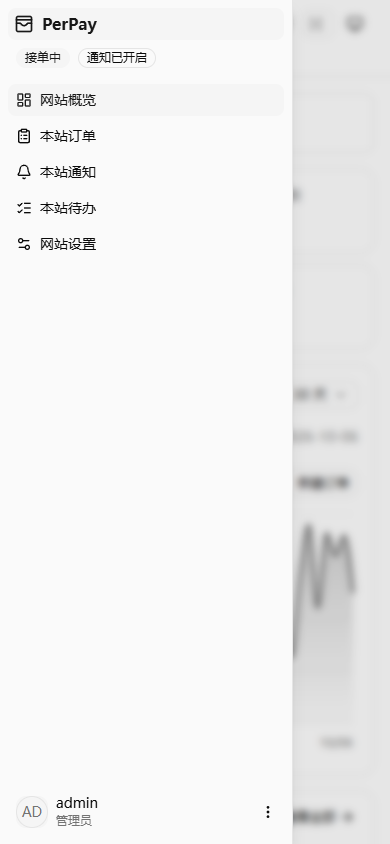

<!-- SPDX-License-Identifier: MIT -->

# 一级汇总与二级网站后台

初版验收：2026-10-07；统一侧栏更新：2026-10-09。分支 `feat/1.0.0`，应用 1.0.0，schema 34。
这次只调整管理空间，不新增网站管理员、部署实例、支付宝应用或数据库迁移。

本轮布局与信息精简的对照、错误状态与保留的安全提示见[后台界面整理验收](admin-layout-acceptance.md)。

## 如何使用

1. 登录 `/admin/` 查看全部网站。侧栏主导航固定显示总览、订单、待办、通知；设置位于底部全局管理分组上方，下方依次为共享账本、运行状态和账户。选择单个网站后，菜单名称与位置保持一致。
2. 选择单个网站后，业务页面使用 `/admin/sites/:clientId` 下的地址；选择“全部网站”恢复全局业务范围。“设置”按选择分别进入实例设置或网站设置。
3. 点击侧栏“业务网站”整行展开或收起二级菜单，文字、当前网站名和箭头均可操作；收起时仍显示当前选择。展开后的“管理网站”进入网站管理列表。网站列表不限制高度、不设置内部滚动条，超长内容沿用侧栏整体滚动。切换网站保留当前业务栏目，订单／通知详情回到对应列表，单站账务证据回到待办。网站较多时使用“加载更多网站”。展开状态在当前标签页保留，进入另一个网站时自动展开。
4. 网站设置分为基本信息、订单设置、接入与通知、收银台展示。各组保存完整加载快照及网站版本，只有本组可编辑；并发冲突保留草稿，需要核对最新配置后再操作。默认模板只在一级。
5. 一级商户订单号查询和测试收款要为本次操作选择网站；二级固定本站，不再显示整页网站筛选器。

网站后台不是另一个权限账号：同一管理员仍可主动回到一级管理其他网站；网站作用域是服务端核对的操作边界，而不是只隐藏其他网站的前端筛选。

共享账本、运行状态和网站管理页面始终使用全局接口，页面标题标明“全局”。这些页面通过 `selected_site` 地址参数记住所选网站，供下一次业务导航使用；参数不作为 API 筛选或写入身份。刷新、复制地址和前进后退都能恢复选择，真实网站业务路径优先于该参数。仅改变这份导航选择时保留全局页面的草稿与操作对话框；实际离开页面或切换业务范围仍执行原有离开保护。

## 操作与故障边界

- 二级订单、通知、相关证据、导出和操作均使用本站 API；其他网站资源 ID 返回不存在，不自动转到全局详情。
- 本站订单可人工关联共享收入流水、撤销关联和标记退款；全部原财务校验继续执行。涉及共享冲突或其他网站归属时，提示到一级共享账本处理。
- 未归属流水及共享冲突只在一级，不把它们算作本站“零冲突”。页面明确区分实例共享收款引擎状态与网站接单／通知状态。
- 切换网站沿用未保存内容和未确认操作的离开保护。密钥离开或隐藏后，晚到明文不再显示；隐藏不代表取消轮换。
- 未确认的测试收款保留原网站与原操作 ID。即使切换到另一个网站，重试也不会改绑；完成后再创建新请求时使用目标网站。
- 网站信息刷新失败时显示错误，不退回全局数据；已加载草稿保留。恢复网络只恢复读取，不自动重放保存或财务写入。

## 本地预览

在仓库根目录使用 Node.js 24：

```sh
npm ci
npm run build
npm run demo:preview
```

浏览器打开 `http://127.0.0.1:6192/admin/`，演示密码为 `123456`。也可用
`npm run demo:preview -- --port 6193` 指定另一个本地端口。
演示只绑定回环地址，使用独立临时数据库、八个合成网站和非付款二维码；不读取生产数据或调用真实支付宝／通知服务。
覆盖近 90 天的日常订单，并将订单生命周期、人工收款处理、退款标记、账本冲突和通知历史分散到不同日期；具体入口见[本地演示场景](preview-scenarios.md)。
除登录、退出及有会话与 CSRF 保护的全局／本站 CSV 导出外，所有写操作被拒绝；按 Ctrl+C 停止后清理临时实例。
更新检查有意返回 503，不冒充在线检查成功。

## 实际浏览器验收

以下截图和浏览器记录对应 2026-10-07 的初版两级后台。2026-10-09 的统一侧栏已另行更新导航与组件回归；本轮浏览器工具因无法核验管理员安全策略而拒绝访问本地预览，桌面和移动端的视觉验收尚未完成，旧截图不代表新侧栏。

使用本机 Chrome 154.0.8037.98（Playwright 驱动，真实浏览器，非 jsdom），桌面 1440×1000、1920×1000 和移动端 390×844；明暗主题均检查。
全程访问隔离的本地只读演示。截图使用合成订单，不能用于证明真实付款。

| 项目 | 结果 |
| --- | --- |
| 一级汇总与批量网站表 | 各网站可进入后台；全局金额与分页网站行分开呈现 |
| 二级导航、订单详情及返回 | 路径、侧栏和数据保持本站；返回保留列表条件 |
| 网站选择、深链接刷新、前进／后退 | 进入目标网站概览，不串用其他网站资源 |
| 设置分组 | 每组只显示相应字段，实例设置和模板不出现在二级导航 |
| 移动端侧栏 | 可以打开、关闭和进入本站页面，无页面级横向溢出 |
| 不存在的网站与越界订单 | 显示错误，不展示另一网站或全局详情 |
| 测试收款 | 二级固定网站；演示不执行真实创建 |






## 自动化证据与验证范围

2026-10-09 统一侧栏初轮验证：`npm run typecheck:admin`、`npm run test:admin`（97 个文件、1272 项测试）和 `npm run build:admin` 全部通过。后续整行折叠、取消列表内部限高及设置下移的调整通过侧栏与工作空间 34 项回归，类型检查与管理员端构建均通过。桌面与移动端的视觉验收受浏览器工具策略限制，未作为本轮已完成项目。

- `test/site-admin-workspace.test.ts`：会话保护、路径身份、列表与游标、导出、资源越界、事务内财务校验、历史重放、通知尝试／重投及回执地址、批量概览。
- `web/test/workspace.test.tsx`：旧链接迁移、固定 SDK 作用域、晚到响应隔离、真实路由布局、网站读取错误、跨网站测试请求恢复和草稿保留。
- `web/test/navigation-selection.test.ts`、`web/test/sidebar-sites.test.tsx`：统一菜单、全局页面的导航选择记忆、实际 API 范围、栏目与详情切换、分页历史、草稿及未确认操作保护。
- 网站设置、密钥隐藏、原操作恢复及全部原有前端回归继续运行。
- `test/preview-demo.test.ts`：八个合成网站、汇总口径、二级读取／导出、只读保护和禁止外部 fetch。
- `test/preview-scenarios.test.ts`：订单生命周期、财务处理、通知投递、90 天历史分布及跨网站证据一致性。

2026-10-07 初版验证的 `npm run check`、`npm run build` 均通过：API 契约与生成类型检查、双端类型检查、后端 1040 项通过／3 项 POSIX 权限测试在 Windows 跳过、前端 91 个文件共 1110 项通过，以及管理员端、收银台和服务端构建。初版 Chrome 走查无页面脚本错误、无外部网络请求；真实财务写入未在只读浏览器演示中执行，财务隔离由 Hono／SQLite 集成回归和前端操作测试验证。

实现原子提交：`8a46069`（网站接口与批量概览）、`bb5588a`（两级后台）、`1cc5a19`（操作回执地址保留范围）；文档、演示和截图单独提交。没有重写之前的提交。
未执行真实支付宝支付／查询、外部通知、Docker／Linux 部署、远程 CI 或生产验收；本地浏览器与测试替身不能替代这些验证。
未推送、合并、打标签、发布或部署，也未修改本地多网站评估记录和安全审计报告。

升级仍按 [1.0.0 说明](../releases/v1.0.0.md)：停止 app 和 backup，保留备份和主密钥，使用匹配数据库版本的维护工具。不能用旧程序直接打开新库。
