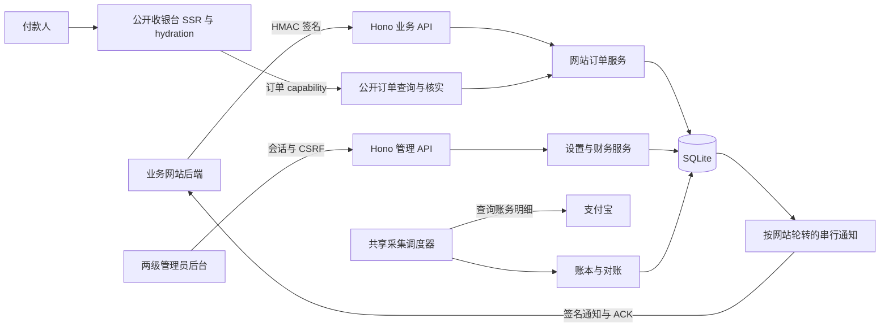

<!-- SPDX-License-Identifier: MIT -->

# PerPay 项目交接文档

历史交接日期：2026-10-07（北京时间）。本文保留当时的开发交接快照。

2026-10-23 补充：当前源码进入 `1.0.0-alpha.1` 发布准备，运行时为 Node.js 24.22.1，数据库 schema 为 35。当前版本、破坏性变更与验收边界见[预发布说明](../releases/v1.0.0-alpha.1.md)；以下版本与分支信息继续作为历史快照保留。

2026-10-21 补充：支付宝流水查询引入索引迁移 35，当前数据库兼容声明为 24—35。以下 schema 34、HEAD 和验证数量均为历史快照，当前升级操作以[维护说明](../maintenance.md#固定版本与回滚)及[版本说明](../releases/v1.0.0.md#数据库与升级)为准。

本文中的 HEAD、工作区、网站数量、预览端口和验证数量均属于当时的记录。接手当前版本时先核对 Git 状态与最新提交；本地预览以[本地演示场景](preview-scenarios.md)为准，界面变更参见[概览验收记录](overview-records.md)和[列表对齐记录](list-alignment.md)。下文旧预览端口与启动建议不作为当前操作指引。

**当前交付是 1.0.0 开发分支：多网站、一级汇总与二级网站后台、后台布局精简均已实现并提交。下一步应先复核当前状态，再处理明确的新需求或发布前验证，不要重新实施已完成的改造。**

## 1. 交接基线与协作约束

| 项目 | 本次核验结果 |
| --- | --- |
| 仓库 | `D:\Project\Server\PerPay` |
| 分支 | `feat/1.0.0` |
| HEAD | `3d6002a673ee1517cab570c2b9cbcd3deb7234ad` |
| 最新提交 | `docs(后台): 更新界面截图与交互验收记录` |
| 应用版本 | `1.0.0`；版本一致性检查通过 |
| 数据库 | 最新 schema 34；代码声明兼容范围 24—34 |
| 本地 main | `b4a4a11`，0.3.2 发布准备提交；开发分支领先其 34 笔提交 |
| 工作区 | 开始交接时干净；本次仅新增本文件并补充 README 入口 |
| 远程状态 | 当前分支未配置 upstream；本地没有 `v1.0.0` 标签。本次未 fetch，也未查询远程 Release、镜像或 CI |

来源为此前开发交接记录、当前代码、Git 历史及仓库验收记录。此前记录为未推送、合并、打标签、发布或部署；这与“版本号已改为 1.0.0”是两件事，不能据此声称版本已上线。

沿用最近一次明确的协作边界：

- 对需求前提保持批判性，发现错误直接指出，并以当前代码和契约核对。
- 在 `feat/1.0.0` 继续开发；功能修改按可独立验证的单元原子提交，不重写已有提交。
- 未有新指令前，不自动推送、合并、打标签、发布或部署。本次交接文档未执行提交。
- 不修改或提交 `docs/multi-business-websites.local.md` 与 `docs/security-audit-2026.md`。前者当前存在且被本地 Git 排除；后者本次未在工作区找到，不要自行重建。
- UI 调整先查看现有实现与历史，再验证真实浏览器；单元测试不能代替视觉验收。

后续提交会使本文件的 HEAD、测试数量和运行状态过时，接手时先运行 `git status --short`、`git log -5 --oneline`。

## 2. 产品定位与已经完成的范围

PerPay 是面向个人开发者的自托管经营码收款系统。多个自有业务网站共享一套支付宝开放平台应用、经营收款码、账本采集与对账流程，每站拥有独立 API 密钥、通知密钥、订单权限和业务配置。

网站后台由**同一个管理员账号**切换管理；没有新增网站管理员、子商户、独立收款账户或独立结算余额。管理员“退款标记”只记录管理员声明，不执行或验证实际退款。

### 2.1 两级后台

| 层级 | 路由 | 职责 |
| --- | --- | --- |
| 一级全部网站 | `/admin/` | 全局概览、各网站汇总、全部订单、全部通知、全局待办、共享账本、实例设置和运行状态 |
| 网站管理 | `/admin/sites` | 紧凑网站列表、进入后台、创建网站、默认模板入口 |
| 创建网站 | `/admin/sites/new` | 仅填写名称，复制当前加载的模板策略 |
| 默认模板 | `/admin/sites/defaults` | 分组标签编辑同一份草稿，一次保存 |
| 二级网站后台 | `/admin/sites/:clientId` | 本站概览、订单、通知、待办、本站订单相关证据与操作 |
| 网站设置 | `/admin/sites/:clientId/settings/{basic,orders,integration,display}` | 基本信息、订单设置、接入与通知、收银台展示 |

二级订单、通知及其详情使用网站路径下的 `orders`、`notifications` 子路由；待办使用 `work-items`。相关财务证据详情使用 `reconciliation/:kind/:resourceId`。

顶部切换网站默认进入目标网站概览。旧业务链接的 `?api_client_id=...` 会迁移到二级路径，保留其他业务筛选，清除旧 `cursor` 和 `page`。不存在或越界的网站、资源显示错误，不回退到全局或 `default`。

### 2.2 最新 UI 决策

- **全部网站搜索控件已移除**：包括首页网站汇总、网站列表、顶部切换器和单次操作选择器。保留分页／加载更多；重名时用短 ID 区分。后端网站查询的 `q` 能力仍存在，不能把 UI 精简解释为删除 API 搜索。
- 订单关键词、商户订单号、状态、日期等业务查询保留。一级精确商户订单号查询和测试收款需要为本次操作选择网站，二级固定本站。
- 创建网站只填名称。读取模板失败不能创建；初始接单开启、通知关闭、通知及返回来源为空，不自动签发密钥。API 仍提交完整配置和原操作 ID。
- 网站设置按四组保存，各组使用加载时的完整配置快照与网站 `revision`；模板使用自己的版本。冲突保留草稿，不覆盖其他组的新数据。
- 设置内容最大约 56rem，数字输入约 12rem、名称约 28rem；相关短字段桌面双列、窄屏单列，标签在控件上方。公共内容容器另有收缩／全屏切换，不把短表单拉成整页宽。
- 低频通知参数收在高级设置，字段错误时自动展开并定位。普通保存不做泛化二次确认；暂停接单、关闭通知、来源变更、轮换、删除及财务操作保留影响确认。
- 二级列表不重复堆叠网站名称和客户端 ID；一级保留所属网站名称。详情先呈现业务结果和操作，技术 ID、指纹、原始结构按需查看。
- 运行状态正常项紧凑呈现，异常原因与下一步处理保留。未知数据不能显示成零，停止等待不能表述为取消服务端操作。

当前前端沿用 **shadcn/ui、Base UI、Tailwind CSS、Nova / Neutral**。早期“仅 API 管理”“不使用组件库”方向已被后续明确方案和实现替代；本轮不应据此换回原生 CSS 或重新选型。

### 2.3 最近的关键提交

| 提交 | 接手时需要知道的变化 |
| --- | --- |
| `20b446e` | 正式启用 1.0.0 / schema 34 多网站迁移与运行回归 |
| `0486aec`、`5868909` | 通知网站标识、字段错误反馈、网站保存／轮换后的缓存版本同步 |
| `f1fabf4`、`63baace`、`0ecef65` | 并发准入、迁移回滚、双站投递轮换与连续重启回归 |
| `db0ba9e` | 隐藏密钥后忽略晚到的明文响应 |
| `6d6d0c6` | 概览统计卡片数量和跳转保持网站范围 |
| `8a46069` | 网站作用域管理 API 与分页批量网站概览 |
| `bb5588a`、`1cc5a19` | 两级后台及操作回执地址范围修正 |
| `2eb6933` | 两级后台文档、演示与截图 |
| `b939e79`、`302cb8f` | 统一字段布局、名称创建、去除网站搜索 |
| `01afbbc`、`0098640` | 页面信息精简、模板保存区及通知说明修正 |
| `3d6002a` | 最新截图和布局验收记录，即本交接基线 |

完整提交链：`git log --reverse --oneline v0.3.2..feat/1.0.0`。此前 review 发现的密钥隐藏竞态与概览卡片范围问题已有修复及回归，不应再次当作未处理缺陷。

## 3. 技术架构与代码入口

运行时使用 Node.js 24、TypeScript、Hono、内置 `node:sqlite`；校验使用 Zod。后台和公开收银台使用 React 19 / Vite，查询与列表使用 TanStack Query / Table，图表使用 Recharts。依赖精确范围以 [package.json](../../package.json) 和锁文件为准。



图中的公开“核实”请求触发共享查账流程，不是付款成功证明，也不是独立直连支付宝的前端请求。

| 位置 | 职责及阅读重点 |
| --- | --- |
| [src/main.ts](../../src/main.ts)、[src/config.ts](../../src/config.ts) | 启动、配置、主密钥、服务装配及停止流程 |
| [src/http/app.ts](../../src/http/app.ts) | Hono 路由、管理员与业务鉴权、CSRF、同源、演示保护和错误响应 |
| [src/sites/](../../src/sites/) | 网站模型、事务存储、网站绑定密文、迁移与网站资源范围检查 |
| [src/database/](../../src/database/) | schema 迁移、订单存储、事务财务操作、审计链、完整性与维护锁 |
| [src/orders/](../../src/orders/) | 订单准入、幂等、金额分配、策略快照、二维码关联与收银台 token |
| [src/runtime/](../../src/runtime/) | 实例运行快照、支付配置切换、共享任务及核实请求协调 |
| [src/ledger/](../../src/ledger/)、[src/reconciliation/](../../src/reconciliation/) | 采集节奏、游标与退避、到账账本、自动匹配及人工证据 |
| [src/notifications/](../../src/notifications/) | 通知物化、轮转领取、租约、签名、传输、ACK 和重投 |
| [src/settings/](../../src/settings/)、[src/identity/](../../src/identity/) | 实例配置、管理员会话、白名单与离线恢复 |
| [src/backup/](../../src/backup/) | 自动备份、健康检查、离线恢复和备份发布锁 |
| [src/infrastructure/alipay/](../../src/infrastructure/alipay/)、[src/infrastructure/network/](../../src/infrastructure/network/) | 支付宝适配、传输与网络地址安全 |
| [web/src/App.tsx](../../web/src/App.tsx)、[web/src/workspace.tsx](../../web/src/workspace.tsx) | 路由、网站上下文、网站元数据加载与错误门禁 |
| [web/src/lib/workspace-scope.ts](../../web/src/lib/workspace-scope.ts)、[web/src/lib/workspace-query.ts](../../web/src/lib/workspace-query.ts) | 范围链接、旧链接迁移、查询隔离 |
| [web/src/api/workspace.ts](../../web/src/api/workspace.ts)、[web/src/api/client.ts](../../web/src/api/client.ts) | 在调用时固定网站的 API 包装及请求处理 |
| [web/src/pages/CreateSite.tsx](../../web/src/pages/CreateSite.tsx)、[web/src/pages/Sites.tsx](../../web/src/pages/Sites.tsx) | 最小创建流程、网站设置、默认模板与密钥生命周期 |
| [web/src/drafts.tsx](../../web/src/drafts.tsx)、[web/src/lib/fixed-operation.ts](../../web/src/lib/fixed-operation.ts) | 草稿离开保护、固定请求、未知结果与原操作恢复 |
| [web/src/components/](../../web/src/components/)、[web/src/styles.css](../../web/src/styles.css) | 共享表单、列表、详情、弹窗、主题与布局 |
| [web/src/checkout/](../../web/src/checkout/)、[src/http/web/](../../src/http/web/) | 收银台 SSR / hydration、轮询、二维码下载及资源白名单 |
| [openapi.yaml](../../openapi.yaml)、[web/src/api/generated/](../../web/src/api/generated/) | 接口契约与生成客户端；生成目录不手改 |

生产中 Hono 同时提供后台、公开收银台和 API，不需要另部署前端服务。公开构建产物为 `web-dist/admin/`、`web-dist/checkout/`；`web-dist/checkout-ssr/renderer.cjs` 为私有 SSR 产物，服务端编译结果在 `dist/`。不要公开 SSR、源码、source map 或构建清单。

## 4. 修改时必须保留的业务规则

### 4.1 网站归属与配置

- 业务网站身份来自验签后的客户端 ID；管理员二级接口身份来自路径。不能用业务正文选择网站，网站管理路径也不能重复传正文／查询 `api_client_id`。
- 网站 ID 不可变；未知网站不回退 `default`。升级实例中的 `default` 是保留的普通旧网站，新装不生成隐藏网站。
- 订单 ID 全局唯一；商户订单号、幂等键、nonce 按网站隔离。全局管理员按商户订单号查询时必须指定网站。
- 网站、模板、实例各自持有相应配置及版本；默认模板只用于新建快照，不向已有网站动态继承。
- 接单状态与通知开关独立。暂停仅阻止新订单，旧单查询、关闭、付款、核实、对账和通知继续；暂停不等于吊销泄露密钥。
- 删除只允许无历史订单、事件和通知的网站，保留不可复用身份墓碑与审计。

### 4.2 金额、账本与财务证据

- 金额按整数分处理；多个网站共享**完整应付金额**占用与冷却，优先最小可用尾差。网站待付款上限不预留金额槽位。
- 历史订单的有效期、冷却和原二维码关联使用已有快照；不能被新设置覆盖。网站展示设置变化可以影响旧收银台的展示。
- 合法幂等重放优先于新单准入；暂停、满额、改来源不能重新解释已成功的历史请求。
- 支付宝流水不带 PerPay 网站身份。归属不唯一时保留异常，不猜测网站；共享或未归属冲突只在一级处理。
- 二级可为本站订单人工关联共享收入流水、撤销关联和标记退款；跨站证据或共享冲突返回 `409 site_scope_conflict`，其他网站资源返回 404。
- 退款标记不移动资金、不改变付款状态、不生成退款通知。忽略提醒不消除原异常，也不停止自动重试。
- 财务命令保留原操作编号、版本、固定证据与审计；历史幂等回执不一定代表资源的当前状态。

### 4.3 通知与密钥

- 一个实例共用采集调度器；多个收银台的核实请求合并，仍遵守最小间隔、退避、限流和分页续采。
- 通知在可执行网站间轮转并串行发送；一个网站的网络超时仍会影响其他网站等待时间，不能宣称已具备独立并行队列。
- 在途通知使用捕获的密钥及策略，下一次尝试读取当前配置。关闭通知保留任务，恢复不自动复活死信。
- 通知来源与返回来源独立配置；实际通知连接继续经过 DNS/IP 与传输安全校验。
- API 密钥轮换后旧密钥立即失效；通知在途签名可能仍用原密钥。轮换不重启共享采集。
- 网站密文绑定实例、网站、用途和版本。保留 HKDF / AES-256-GCM、AAD 与严格完整性检查，不添加解密回退。

### 4.4 前端生命周期

- 查询缓存、详情、导出和返回导航必须携带网站范围；请求发出时固定网站与资源，旧响应不能出现在新网站。
- 网站设置失败保留草稿；网站元数据刷新失败时禁止继续操作，不把草稿无声清除。
- 密钥只显式查看，明文不进入查询缓存或视图过渡快照。隐藏、离开、切站、标签页隐藏或超时应使明文显示失效；不能把隐藏说成取消已经提交的轮换。
- 超时、断网、离开、HTTP 2xx 但正文损坏都不能直接判断写入成功或失败。未知结果保留原请求，仅由用户明确重试，不在网络恢复时自动重放。
- 待恢复测试收款始终属于原网站，不能在切站后改绑。草稿与固定财务操作共用离开保护。
- 公开收银台只使用 capability 及公开投影，不读取管理 API 或密钥。保留到期处理、无脚本入口、后台暂停、BFCache、取消和旧响应保护。

## 5. 接口与业务接入

| 接口面 | 身份与用途 |
| --- | --- |
| `/api/v1/...` | 网站 HMAC；下单、查询、关闭及本站状态 |
| `/api/admin/v1/...` | 管理员会话；全局管理 API 保留，部分查询可按 `api_client_id` 筛选 |
| `/api/admin/v1/sites/:clientId/...` | 同一管理员会话，额外由路径固定网站并在服务／事务中校验资源归属 |
| `/api/public/v1/checkouts/:token/...` | 公开收银台 capability；限制为订单相关的公开能力 |
| `/healthz`、`/readyz` | 实例进程／数据库健康与共享收款引擎就绪；不代表某个网站一定可接新单 |

网站管理 API 的路由集合见 [src/sites/admin-scope.ts](../../src/sites/admin-scope.ts)，复用原服务与事务，不通过内部 HTTP 转发。`GET /api/admin/v1/sites/overview` 分页批量聚合，避免逐站请求；全局总数不能累加当前分页网站行得到。

统计中，`confirmed_count` / `confirmed_amount_cents` 是所选北京时间区间内的确认指标，`pending_orders` / `work_items` 是当前状态指标。待办总数按完整 ACTIVE 视图统计，不能取首页四条预览的长度；失败显示未知。

完整签名与 ACK 实现看 [USAGE.md](../../USAGE.md) 和[调用端示例](../../examples/node-client/README.md)。尤其注意：

- API 签名时间戳为 Unix **秒**，通知时间戳为 Unix **毫秒**；请求签名包含规范化路径／查询、客户端 ID 和原始正文摘要。
- API 重试保持业务请求体及幂等键，重新生成时间戳、nonce、签名；API 密钥只放在网站后端。
- 通知先验签，再按事件 ID 持久化去重、按 `order_version` 防止乱序回退，完成业务事务后返回协议 ACK。HTTP 200 本身不等于有效 ACK。
- 网站 API 密钥和通知密钥不能混用；示例必须显式配置 `PERPAY_CLIENT_ID`，本地示例数据库绑定实例来源与网站 ID。
- 旧单站全局密钥／通知管理写入口返回 `410 site_settings_moved`；混合设置字段不再接受。对接脚本需要按当前 OpenAPI 更新。

## 6. 本地运行与开发

### 6.1 环境与只读预览

要求 Node.js `>=24.15.0 <25`，开发、CI 与 Docker 统一使用 Node.js **24.22.1**。部署目标为 Linux / Linux 容器；Windows 开发测试通过不等于 Linux 权限和容器验收通过。

在仓库根目录执行；已有依赖不必为了阅读文档重复安装：

```powershell
npm ci --ignore-scripts
npm run build
npm run demo:preview
```

本次 HTTP 探测确认 [http://127.0.0.1:6192/admin/](http://127.0.0.1:6192/admin/) 返回 200，包含 `X-PerPay-Demo: read-only; health=simulated`。这是会变化的进程状态，接手时重新核验。演示登录密码为 `123456`，仅用于这个本机临时演示。

[scripts/preview-demo.ts](../../scripts/preview-demo.ts) 使用独立临时目录、随机主密钥、两个合成网站及合成订单，不导入正式启动入口、不连接支付宝、不发送通知；健康状态为模拟值。正常 `Ctrl+C` 退出会清理本次临时目录。业务写操作被拒绝，仅保留登录、退出及导出等必要交互，不能在此完成真实创建／保存／财务写入验证。

已有服务占用 6192 时复用它，或另选端口：

```powershell
npm run demo:preview -- --port 6193
```

管理员页面需要热更新时，保持演示运行，在另一个 PowerShell 中启动：

```powershell
$env:PERPAY_DEV_API_URL = 'http://127.0.0.1:6192'
npm run dev:admin
```

访问 [http://127.0.0.1:6191/admin/](http://127.0.0.1:6191/admin/)。Vite 默认端口 6191，默认代理到 `http://localhost:6190`；连接 6192 演示必须显式设置上述代理。收银台始终由后端 SSR 提供，修改后需要 `npm run build:checkout` 并重启隔离后端，Vite 不代替其构建。

### 6.2 需要可写开发后端时

只读演示不能承担写操作验收。自动化优先使用现有 Hono / SQLite 夹具；需要人工检查初始化与配置保存时，可在新的 PowerShell 中使用独立持久目录：

```powershell
$devRoot = Join-Path $env:LOCALAPPDATA 'PerPay\dev-1.0.0'
$env:PERPAY_HOST = '127.0.0.1'
$env:PERPAY_PORT = '6190'
$env:PERPAY_PUBLIC_URL = 'http://127.0.0.1:6190'
$env:PERPAY_TRUSTED_PROXY_CIDRS = ''
$env:PERPAY_DATA_DIR = Join-Path $devRoot 'data'
$env:PERPAY_BACKUP_DIR = Join-Path $devRoot 'backups'
$env:PERPAY_SECRETS_DIR = Join-Path $devRoot 'secrets'
Remove-Item Env:PERPAY_MASTER_KEY -ErrorAction SilentlyContinue
npm run dev
```

这些配置只用于独立开发数据；首次启动自动生成并保存主密钥，后续保持该目录和密钥，不要每次重启换密钥。若已有同名开发目录，先确认其用途再复用。数据与备份目录必须分离。此启动示例已按当前配置代码核对，本次没有实际启动第二个可写实例。

另一个前端终端设置 `PERPAY_DEV_API_URL=http://127.0.0.1:6190` 后运行 `npm run dev:admin`。首次访问后创建开发管理员；无真实上游配置时收款未就绪是正常状态。正式入口会装配后台任务，输入真实支付宝或通知配置可能触发真实外部请求，财务验证继续使用隔离合成夹具。

### 6.3 构建、类型与测试命令

| 命令 | 内容及使用时机 |
| --- | --- |
| `npm run check:version` | package、锁文件、OpenAPI、源码、Docker / Compose 版本规则 |
| `npm run api:types` | 修改 OpenAPI 后重新生成客户端 |
| `npm run api:check` | 校验生成客户端是否与契约一致，不手动修补生成文件 |
| `npm run typecheck` | 服务端与前端 TypeScript |
| `npm run test:admin` | 前端 Vitest / jsdom |
| `npm run test:node` | 服务端 Node 测试；单独执行前先构建后台和收银台 |
| `npm test` | `pretest` 先构建后台与收银台，然后运行双端全量测试 |
| `npm run check` | 版本、生成类型、双端类型、全量测试及服务端构建 |
| `npm run build` | 管理端、收银台客户端／私有 SSR、服务端全部构建 |
| `npm audit --audit-level=high` | CI 使用的全量锁定依赖审计，包含开发依赖 |

常规交付复现入口为 `npm run check`、`npm run build`、`git diff --check`。本次没有修改业务代码，不重新执行全量测试和全量构建来覆盖已有验收记录。

构建使用仓库中的组件源码，不依赖 shadcn CLI；组件维护规则与本地 vendored CSS 的来源见 [web/README.md](../../web/README.md)。不要为编写文档或正常构建额外安装组件 CLI。

## 7. 数据、升级、备份与发布

### 7.1 schema 34 的含义

[src/database/migrations.ts](../../src/database/migrations.ts) 已正式注册迁移 34，正式启动强制使用网站模型。24—34 是当前程序的数据库兼容声明，不是旧程序可以读取 schema 34 的承诺。

迁移在事务内保留旧网站身份、密钥明文值及版本、订单与通知引用、策略快照和历史二维码；业务密文重新绑定网站。缺少必要主密钥、密钥错误或数据损坏会使迁移失败回滚；从未签发的业务密钥不会自动补发。

应用数据库为数据目录下的 `perpay.sqlite3`。Compose 的 `perpay-data`、`perpay-backups`、`perpay-secrets` 分别保存运行数据、备份和主密钥；恢复配置需要原主密钥，仅有数据库备份不够。

### 7.2 升级与恢复的操作顺序

详细命令以 [1.0.0 版本说明](../releases/v1.0.0.md) 与[维护说明](../maintenance.md)为准：

1. 先确认目标构建或镜像实际存在；用旧版本完成升级前备份，并单独保存主密钥。
2. 停止 `app` 和 `backup`，停止其他写入进程；将 `app`、`backup`、`maintenance` 切到同一份支持 schema 34 的构建。
3. 先启动 `app` 完成迁移，验证登录、旧网站身份与密钥、历史订单和二维码、配置、采集对账、通知及健康状态。
4. 在隔离环境验证新网站、备份及恢复后再启动自动备份服务。
5. 回退必须使用升级前备份与原主密钥，不能让 0.3.2 直接打开 schema 34，也不能手改 schema 数字或业务密文。升级后已有新交易时，不能直接用旧备份覆盖。

不要执行 `docker compose down --volumes`，不要删除唯一的数据或主密钥副本。密码重设、白名单锁出和遗留维护锁有各自的离线恢复命令，按维护文档执行，不通过删除数据库解决。

### 7.3 当前流水线

- [ci.yml](../../.github/workflows/ci.yml)：`main` push / PR 触发，Ubuntu 上安装锁定依赖，运行 `npm run check` 和全量依赖审计。
- [container-validation.yml](../../.github/workflows/container-validation.yml)：手动容器验证，包含镜像扫描及 Compose 初始化、备份、恢复 smoke。
- [release.yml](../../.github/workflows/release.yml)：标签触发，验证版本和发布提交可从 `main` 到达，再执行测试、构建、审计、双架构镜像扫描、Compose smoke、发布附件及 Release。正式版才推广稳定 `latest`，预发布不覆盖它。
- [release-recovery.yml](../../.github/workflows/release-recovery.yml)：限定场景的镜像推广恢复，不是跳过扫描或重建固定版本的通道。

根目录 Compose 仍使用稳定 `latest`，它不保证对应本地开发分支。`1.0.0` 发布文档中的镜像标签是目标版本，本次未验证远程存在。发布成功需要分别核对工作流最终结果、镜像摘要／架构和 GitHub Release，不能只看本地构建。

HTTPS 代理部署要填写容器实际看到的直连代理 CIDR，不信任全部来源；默认端口映射仅宿主机可访问。部署说明见[反向代理文档](../reverse-proxy.md)。

## 8. 验证证据与边界

### 8.1 最近完整验收：历史记录，本次未重跑

基线 HEAD 对应的[布局验收记录](admin-layout-acceptance.md)和[两级后台验收记录](admin-workspaces.md)记载：

| 项目 | 最近记录 |
| --- | --- |
| 版本、API 契约／生成类型、双端类型 | 通过 |
| 后端 Node 测试 | 1040 通过，3 项 POSIX 权限测试在 Windows 跳过 |
| 前端 Vitest | 91 个文件，1110 项通过 |
| 构建 | 管理端、收银台客户端／SSR、服务端通过 |
| 真实浏览器 | Chrome 154，1440 / 1920 / 390px，明暗主题 |
| 布局走查 | 24 页，前后共 288 张检查截图；缩略总览及关键页面放大核对 |
| 交互与异常 | 网站切换、移动端导航、详情返回、加载、失败、空数据、长重名、字段错误展开与定位 |

288 张过程截图并非全部提交到仓库。可交付截图位于 [docs/screenshots/](../screenshots/)，不要把本机临时截图或 `.git/` 过程产物当成接手所必需的文件。

### 8.2 本次交接重新核验

- Git 分支、完整 HEAD、相对 main 的提交数量、初始工作区状态和本地标签。
- `npm run check:version`、`npm run api:check`、`npm run typecheck` 均退出 0。
- 6192 演示 `/admin/` 返回 200，演示保护响应头存在；只做 HTTP 探测，没有重新走查浏览器或登录。
- 本文与 README 共 99 个本地链接均可解析，本文引用的 13 个 npm 脚本均存在；Git 差异空白检查通过，包含新增交接文件。

### 8.3 尚未完成的验证

最近验收与本次交接均不能证明：真实支付宝支付／查询、真实外部通知联调、当前分支 Linux / Docker 部署及升级恢复演练、远程 CI、生产验收或 1.0.0 远程发布成功。

只读演示的模拟健康、浏览器截图、受控上游替身和数据库重新打开测试，分别有自己的证据范围，不能互相替代。本文不是新的完整安全审计，也不宣称当前没有其他缺陷。

### 8.4 后续变更的优先回归入口

| 变更方向 | 先看这些测试，再按影响扩展 |
| --- | --- |
| 网站模型、密钥、迁移 | [site-store](../../test/site-store.test.ts)、[site-crypto](../../test/site-crypto.test.ts)、[site-migration](../../test/site-migration.test.ts)、[site-startup](../../test/site-startup.test.ts) |
| 下单、金额、生命周期 | [site-orders](../../test/site-orders.test.ts)、[site-admission-concurrency](../../test/site-admission-concurrency.test.ts)、[site-checkout-runtime](../../test/site-checkout-runtime.test.ts) |
| 通知隔离与投递 | [site-notifications](../../test/site-notifications.test.ts)、[site-notification-view](../../test/site-notification-view.test.ts) |
| 二级 API 与越界 | [site-admin-workspace](../../test/site-admin-workspace.test.ts)、[site-http](../../test/site-http.test.ts) |
| 路由、切站和恢复 | [workspace](../../web/test/workspace.test.tsx)、[dashboard-sites](../../web/test/dashboard-sites.test.tsx)、[site-secret-lifecycle](../../web/test/site-secret-lifecycle.test.tsx) |
| 创建、布局与信息密度 | [site-minimal-flow](../../web/test/site-minimal-flow.test.tsx)、[settings-form-layout](../../web/test/settings-form-layout.test.tsx)、[information-density](../../web/test/information-density.test.tsx) |
| 演示只读及无外部请求 | [preview-demo](../../test/preview-demo.test.ts) |

UI 修改继续检查桌面／手机、明暗、长文本、键盘焦点和滚动可达性；收银台增加生产 CSP、无脚本及 hydration 检查。

## 9. 已知文档差异与下一步

本次没有接到新的功能开发需求，也没有将历史已完成工作重新列为待办。以下是接手时需要处理或持续留意的事项：

| 时机 | 事项 | 完成标准 |
| --- | --- | --- |
| 接手立即 | 复核 HEAD、工作区、预览进程，阅读最新验收记录 | 不覆盖后续提交／未提交修改，不把临时预览当生产 |
| 发布前 | 对最终发布提交执行完整检查及 Linux / 容器验证，覆盖 schema 34 升级、主密钥和备份恢复 | 保存实际运行结果，补足 Windows 跳过项和容器验证边界 |
| 真实接入前 | 在明确的隔离环境验证支付宝查询、付款归属及通知验签／ACK | 记录配置、操作及真实结果；不使用演示健康代替 |
| 维护文档时 | 统一早期开发说明与最新界面规则 | 网站只填名称创建、无网站搜索、二级不重复网站 ID、短字段限宽与上方标签的描述一致 |
| 准备发布时 | 核实当前远程提交、CI、标签与镜像状态 | 以实际远程状态决定后续操作，遵守当前未自动发布的边界 |

已定位的描述差异：

- [multi-site-1.0.0.md](multi-site-1.0.0.md) 的“HTTP 与管理界面集成进度”仍描述早期“首页／订单／通知支持网站筛选”以及列表重复显示网站 ID；当前已由路由绑定的两级后台替代。
- [multi-site.md](../multi-site.md) 的“创建与接入”“管理接口与查询”保留了创建时检查全部策略、通知列表均显示网站 ID 的早期措辞；同文末尾新增章节和当前 UI 已采用名称创建、二级去重。
- [web/README.md](../../web/README.md) 的部分布局文字仍描述显示设置桌面标签与控件按行对齐；当前统一表单规则以 [SettingsForms.tsx](../../web/src/components/SettingsForms.tsx)、[SitePolicyFields.tsx](../../web/src/components/SitePolicyFields.tsx)、[styles.css](../../web/src/styles.css) 和最新布局验收为准。
- 早期多网站验收的 1035 / 1093 等测试数量是阶段结果，最新记录为 1040 / 1110；它们不代表后来测试数量下降。

本次将差异集中记录于交接文档，没有改写阶段开发记录。出现冲突时先核对当前代码、OpenAPI 和最新验收；API 是否支持搜索与 UI 是否提供搜索应分别判断。

## 10. 接手阅读顺序

1. 本文第 1、2、4、8、9 节：基线、已完成内容、业务约束、证据和待补验证。
2. [后台布局验收](admin-layout-acceptance.md)与[两级后台说明](admin-workspaces.md)：最近 UI 决策及截图。
3. [多网站接入](../multi-site.md)、[USAGE.md](../../USAGE.md)、[OpenAPI](../../openapi.yaml)：实际业务协议。
4. [1.0.0 版本说明](../releases/v1.0.0.md)与[维护说明](../maintenance.md)：升级、恢复和破坏性变更。
5. 按待修改功能选择第 3 节代码入口与第 8.4 节回归测试，避免无目标地重做整个项目。

可用于下一段聊天的起始说明：

> 继续 PerPay 项目，先阅读 `docs/development/handoff.md` 并核对当前 Git 状态。交接基线为 `feat/1.0.0` / `3d6002a`，多网站、两级后台和 UI 精简已完成。保留现有 shadcn 方案、网站作用域、财务幂等与未知结果恢复；不要恢复网站搜索或完整创建表单。先处理我明确提出的新需求；不改两份排除文档，不自动推送、合并、打标签、发布或部署。区分历史验收与本次实际验证。
