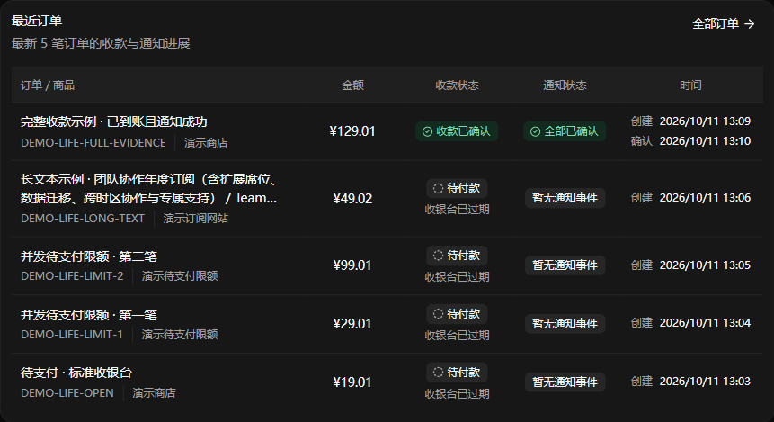
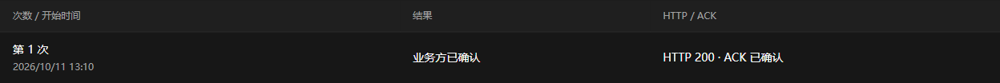
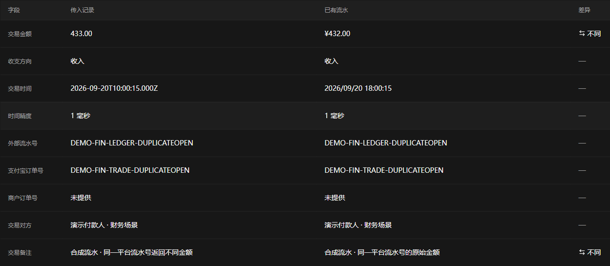
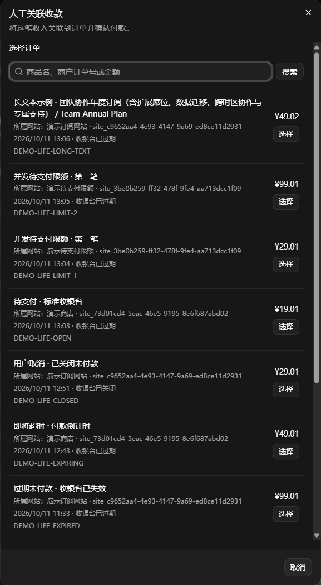

<!-- SPDX-License-Identifier: MIT -->

# 列表对齐

复核日期：2026-10-11（北京时间）。

本文归档各阶段的对齐检查。截图保留拍摄时的界面和演示数据；其中最近订单截图早于收银台提示精简，图中的“收银台已过期”不代表当前展示，当前最近订单已移除收银台状态。

表格的列内水平对齐与行内垂直对齐分别控制。最近订单、订单、待办、通知和账本的金额、状态、次数及时间列，表头与内容均在列内水平居中；订单身份、关联订单和文字列保持左对齐。状态组、换行徽标及多行时间跟随列的中心线，差异金额的标签与数值保持内部对齐。桌面列对齐规则不作用于手机摘要。

`BusinessColumn.align` 支持 `left`、`center`、`right`，显式声明优先于布局默认值；表头与单元格共用同一解析结果。

本次水平对齐通过五组现有回归共 70 项：`recent-orders`、`desktop-list-layout`、`mobile-table-columns`、`dashboard-sites`、`overview-work-items`。管理端类型检查、构建与差异空白检查通过。浏览器核对最近订单四列及四个主列表，居中表头与内容的横向中心误差均小于 0.1px；1920／1480px 的差异金额组居中，390／320px 下无金额裁切或页面横向溢出。

## 行内垂直对齐

- 投递尝试和交易对照表移除顶对齐覆盖，统一使用表格的垂直居中规则。
- 订单、待办、通知、支付关联的双行日期以块级 flex 排版，消除匿名行盒带来的基线偏移。
- 紧凑摘要的身份与右侧金额／状态居中；关联订单及人工候选的金额／选择按钮不再单独贴顶。概览待办的商品与金额保持基线对齐。
- 时间线图标仍对齐事件首行，详情卡片、字段堆叠及换行规则保持原有布局。

现有六组前端回归共 93 项通过：`desktop-list-layout`、`detail-evidence-layout`、`manual-candidate-picker`、`mobile-table-columns`、`recent-orders`、`overview-work-items`。管理端类型检查、构建及差异空白检查通过。

本地合成数据浏览器复核覆盖四个主列表的 1920px 桌面与 390px 触摸布局，均无横向溢出。桌面日期与单元格中线误差小于 0.01px；抽查的紧凑摘要、关联订单和人工候选左右内容中心一致。交易对照的 36 个单元格均为 `middle`，投递尝试的结果与时间块居中。仅打开人工候选列表，未提交财务操作。

