<!-- SPDX-License-Identifier: MIT -->

# 概览待办与最近订单验收

验收日期：2026-10-11（北京时间）。范围为全局与本站概览的两块业务列表及其管理员只读摘要接口。

各节截图保留对应调整阶段的界面和演示数据，可能包含后来移除的提示。当前最近订单不显示收银台状态；历史截图中的收银台提示不作为当前展示依据。

## 展示与数据

- 内容容器达到 68rem 时按 32:68 分栏，较窄时上下排列。首页固定取 4 项待办、5 笔订单，不受趋势日期区间影响。
- 待办首行展示问题与真实状态，第二行并排展示关联商品、所属网站与应付金额，第三行展示带标签的完整商户订单号与提醒时间；空间不足时自然换行。本站不重复展示网站身份，有实际计划时另行保留下次重试或计划投递时间。概览不展示重复分类和尝试次数；无摘要或未关联订单时仍保留带标签的订单或流水引用。财务异常、账本冲突、停止重试的通知在分页前优先，同组按提醒时间倒序；完整待办页保留原有排序选项与默认顺序。
- 待办总数仍来自完整作用域汇总，失败显示未知。`order_summary` 使用现有订单身份的批量查询，无归属事项返回 `null`。
- 最近订单分列展示订单身份、金额、收款、通知和创建／确认时间。金额默认只显示一次；实收存在且与应付不同才展开应付／实收，并强调实收值。缺失实收不显示占位或当作零，实收为零仍参与差异比较。表格自身达到 48rem 时五列，40–48rem 时把时间移入身份，小于 40rem 时使用有字段标签的摘要。全局显示网站身份，本站省略重复网站信息。
- 待办保留投递失败、等待重试、已结束等真实状态；问题标题与整行空白进入处理详情，商品名进入订单详情，不再另列“查看订单”。商户订单号仍可在订单详情查看和复制；提醒时间、应付金额的说明分别保留给读屏和悬停查看。最近订单的金额标签、金额数值分别纵向对齐，创建与确认时间各占一行，表格内容垂直居中；窄屏金额根据可用宽度换行，避免挤压订单身份。
- `notification_summary` 汇总本单持久化通知目标下每个业务事件的最新投递代；未生成的事件计入总数，旧代被重投替代后不计入当前结果。概览只显示汇总状态，不显示“已确认 n/m 项”计数。区分未配置、没有事件、事件等待生成投递以及投递状态；只有所有事件均确认才显示全部已确认。缺失摘要显示未知，不从付款状态或当前网站设置推断通知成功。
- 两列表在前台每 60 秒刷新，后台暂停轮询，返回概览立即重取。沿用现有操作失效与手动刷新；刷新失败保留已有记录并显示错误与重试。
- 只提供查看与处理入口，实际重投、忽略和财务操作仍在既有页面。无需数据库迁移。

## 自动检查

相关回归全部通过：

- 优先级及游标：`admin-work-items`、`admin-list-query`，包括默认顺序、跨组分页、同时间稳定顺序、站点／筛选／排序绑定和旧游标。
- 通知及 HTTP 集成：`admin-order-notification-summary`、`admin-order-summary`、`notifications-store`、`overview-summaries-http` 及既有通知 HTTP 回归；覆盖最新代、部分成功、未生成投递、受限字段读取、登录和跨站拒绝。
- 既有完整预览场景、网站管理员工作区与 OpenAPI 错误契约回归。
- 前端：两个概览列表、概览刷新、本站总数和切站晚响应、导航、公共布局、完整待办操作／恢复与桌面列表布局回归。
- `npm run api:check`、`npm run typecheck`、`npm run build:admin`、`npm run build:server` 和 `git diff --check`。

## 浏览器检查

使用独立合成数据预览和实际管理端生产资源，响应保留生产 CSP，包括 `script-src 'self'` 与 `style-src-attr 'none'`。订单、待办与详情请求实际返回 200，浏览器响应与界面同时保留已收款和等待／重试／失败的通知状态。

- 全局与本站共 26 组常规组合：1440／1920px、390px 手机、320px 极窄屏，浅色／深色，桌面收缩／全屏；另以 1480px 本站容器验证四列布局。均无页面横向溢出，关键字段未因响应式切换消失。
- 使用仅替换浏览器读取响应的夹具，验证长商品名、长商户号、最大合法金额及超规格安全整数金额、缺失实收、退款标记、争议与通知未知；1920／1480／390／320px 均无溢出，商户号完整换行。
- 验证加载骨架、空态和请求失败：空态有真实零总数；失败显示未知总数及两个列表各自的重试入口，未误显示为空。
- 实际点击待办的通知入口和关联订单入口，并用键盘打开最近订单；详情保留本站路径，返回后恢复本站概览。
- 初版桌面和手机截图如下。检查覆盖合成数据与本地界面；未执行真实支付、外部通知或部署。

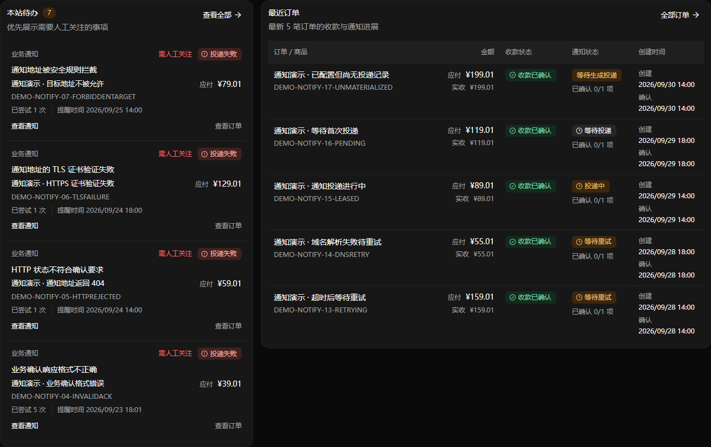

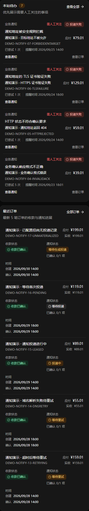

## 排版复核（2026-10-11）

- 删除重复的“需人工关注”，问题标题直接进入对应详情，合并提醒信息与订单入口。
- 金额列从 9.5rem 调整为 7rem，金额标签与数值分别对齐；时间列从 8rem 调整为 10rem，创建和确认各占一行。常规已确认订单行高从约 100px 降至 66px，减少空白并为标题留出空间。
- 通过 `recent-orders`、`overview-work-items`、`dashboard-sites`、`overview-refresh` 共 48 项前端回归，以及管理端类型检查、构建与差异空白检查。
- 本地预览检查覆盖 1920、1480、1280、1024、768、390、320px；另用 320／390px 触摸设备检查点击目标和实际容器宽度。全局与本站、浅色与深色、桌面收缩与全屏均完成相关检查。
- 长商品名、长商户号、大额金额、缺失实收和零金额仍完整保留；专门检查了未触发超长金额标记的大额边界，窄屏会换行且不与标题重叠。通知标题链接和订单键盘导航已在浏览器实际打开。
- 本次使用独立合成数据和当前管理端源码预览，页面无横向溢出，订单与待办请求返回 200。更新检查接口的 503 属于演示预览的已有状态，本次未改动该接口。

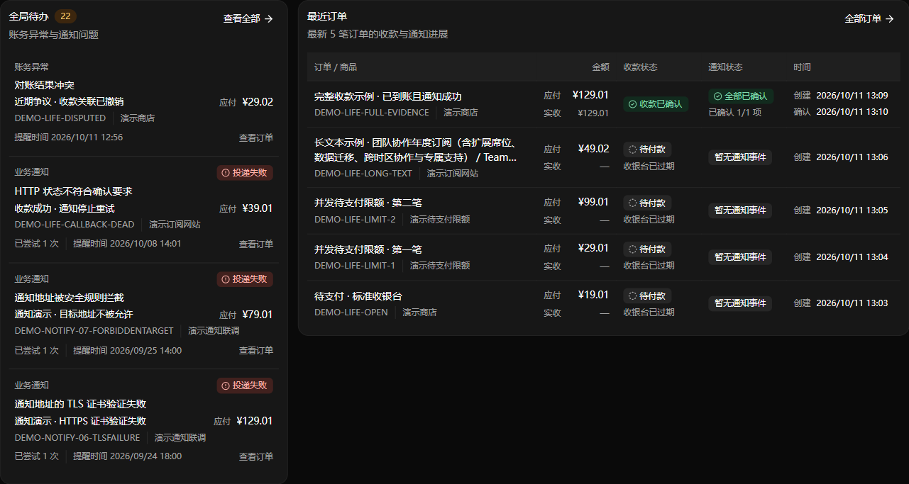

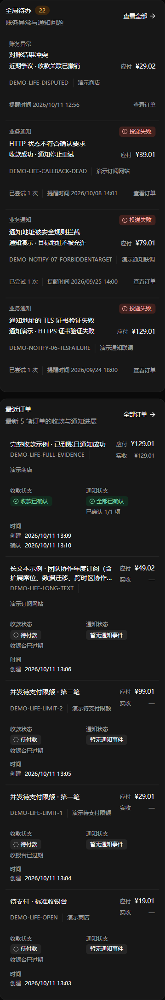

## 金额与通知精简复核（2026-10-11）

- 正常订单仅显示一笔金额，不重复应付／实收；尚无实收记录时也不显示“实收 —”。只有实收存在且不同于应付时，才显示两组标签和数值，并突出实收金额。
- 通知列仅保留汇总状态，删除全部“已确认 n/m 项”计数。部分确认和没有事件仍不会误报全部成功。
- `recent-orders`、`dashboard-sites`、`overview-refresh` 共 35 项回归通过，管理端类型检查、构建与差异空白检查通过。
- 浏览器已检查正常订单单一金额，以及少收、多收、实收为零、部分通知确认；1920／390／320px 下差异金额完整显示，无横向溢出。另用 390px 触摸设备检查正常布局。

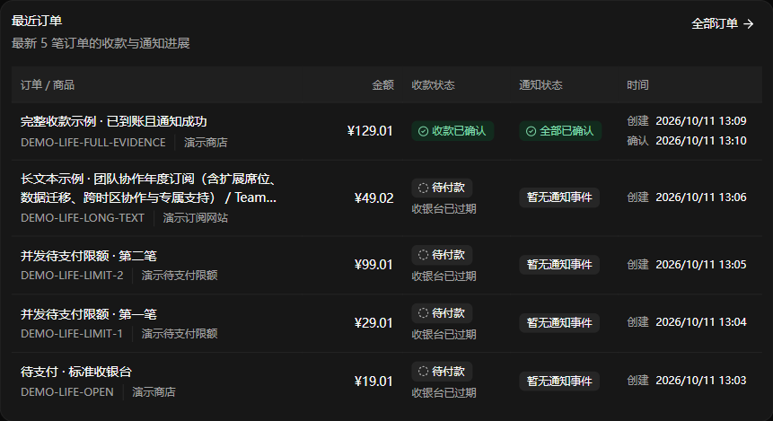

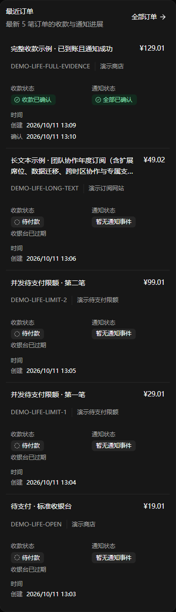

## 待办信息精简复核（2026-10-11）

- 移除卡片重复说明、逐项分类、尝试次数和独立的“查看订单”。问题与真实状态合并到首行，商品名承担订单入口，网站与提醒时间置于底部；真实重试计划仍展示。商户订单号保留展示并明确标注字段名；演示数据已使用数字订单号和正常业务名称，详情中的字段标签和复制入口保持可用。
- `overview-work-items`、`dashboard-sites`、`overview-refresh`、`desktop-list-layout` 共 41 项回归、管理端类型检查、构建和差异空白检查通过。
- 使用当前构建新建本地只读演示实例，验证概览与详情的实际请求和页面。商品名、问题标题、本站商品键盘导航、本站整行空白跳转均正常，本站不重复显示网站身份。
- 浏览器检查覆盖 1920px 深色桌面、390px 深色触屏及 320px 浅色触屏；另以只替换浏览器读取响应的夹具检查超长商品名和大额金额。均无横向溢出；商品链接在触屏上保留 44px 点击高度与两行截断。未执行真实支付或外部通知。

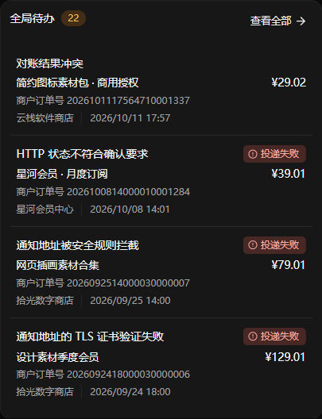

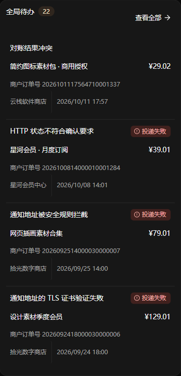

此前精简阶段的截图保留用于对照：[桌面](../screenshots/overview-work-items-clean-desktop.png)、[触屏](../screenshots/overview-work-items-clean-mobile.png)。

## 业务模拟数据与预览复核（2026-10-11）

- 概览恢复带“商户订单号”标签的完整编号。演示订单、流水和支付宝交易号分别使用 22／24／28 位数字字符串；付款人、商品、网站及人工处理备注改为合理的虚构业务内容。详情中已实际检查数字商户号、支付宝订单号及“邓*晨”等脱敏交易对方。
- 数字身份在重复观测中保持稳定，重复付款和全额退款保留付款人关联。场景键、金额、状态、事件时序、网站隔离及只读保护不变；场景定位和编号规则见[本地演示场景](preview-scenarios.md)。
- 前端相关 41 项回归和完整演示数据 10 项回归通过，服务端与管理端类型检查、管理端构建及差异空白检查通过。演示回归同时验证编号唯一、付款人多样性、通知载荷与订单号一致，以及全链路无外部请求。
- 最新构建已在原 `6192` 端口替换旧预览，仅保留一个预览服务；`6191`、`6193`、`6194` 已关闭。浏览器检查覆盖 1920px 桌面、390px 和 320px 触屏，完整商户号均无横向溢出，商品订单入口可正常使用。

## 待办密度调整（2026-10-11）

- 常规待办由四行合并为三行，上下留白由 12px 减为 8px，行内间距由 4px 减为 2px；内容左边缘与卡片标题对齐。每项保留 8px 水平内边距，列表背景向两侧延展，避免悬停时文字贴边，同时保持内容宽度和行高。商品与网站共用一行，金额与状态保留在右侧，完整商户号和提醒时间并排展示。
- 相同数据下，桌面常规单项由约 115px 降为 81px；390px 触屏由约 165px 降为 105px。触屏商品与网站仍各有 44px 点击高度，320px 窄屏允许必要换行。
- 长商品和网站名最多展示两行，完整名称保留在链接可访问名称和悬停提示中；商户号不截断，大额金额可独占一行。使用 40 字网站名、超长商品、64 位商户号、大额金额与有效重试计划检查，无横向溢出。
- `overview-work-items`、`dashboard-sites`、`overview-refresh`、`touch-targets` 共 30 项回归通过；管理端类型检查、构建与差异空白检查通过。浏览器检查覆盖 1920／1440px 桌面、390px 深色触屏、320px 浅色触屏，并核对全局与本站的详情入口。验证使用本地合成数据。

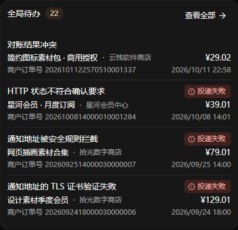

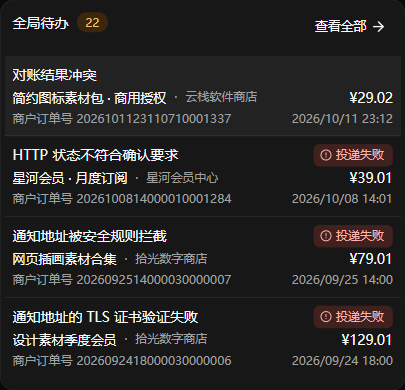

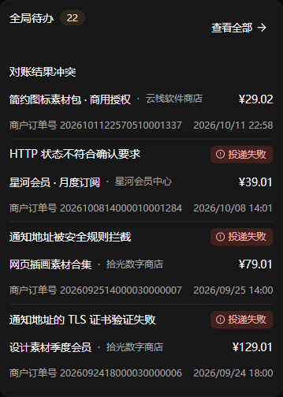

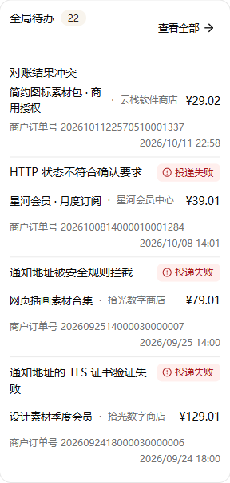
